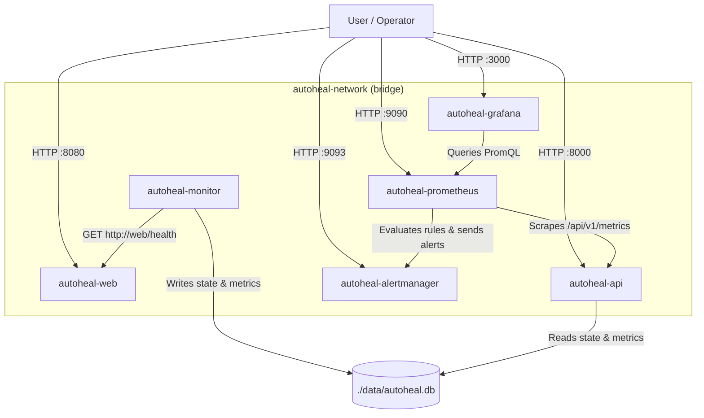

# AutoHeal — Intelligent Self-Healing Infrastructure Automation Platform

## 1. Project Introduction

**AutoHeal** is a phased DevOps infrastructure automation platform designed to monitor containerized services, track incidents persistently, visualize metrics and alerts, and prepare for safe automated remediation.

- **Phase 1 (Completed):** Containerized `nginx:alpine` target web app (`autoheal-web`), JSON `/health` endpoint, isolated `autoheal-network`, and `.env.example`.
- **Phase 2 (Completed):** Asynchronous **Python Monitoring Engine** (`autoheal-monitor`) and decoupled **FastAPI Control Plane** (`autoheal-api`) backed by SQLite (`data/autoheal.db`).
- **Phase 3 (Completed):** **Prometheus**, **Alertmanager**, and **Grafana** observability stack with scrape configs, 7 alert rules, alert grouping/inhibition, a provisioned 10-panel dashboard, and persistent Docker volumes—verified on macOS Apple Silicon (`arm64`).

---

## 2. Technology Stack

| Component | Phase | Purpose |
|---|---|---|
| Docker & Docker Compose v2 | Phase 1–3 | Hardened multi-container orchestration on `autoheal-network` |
| Nginx (`nginx:alpine`) | Phase 1 | Target web server (`/` and JSON `/health`) |
| Python 3.12 + `httpx` + SQLite | Phase 2 | Async monitoring engine and persistent incident store |
| FastAPI + `prometheus-client` | Phase 2 | Control plane REST API & Prometheus `/api/v1/metrics` exporter |
| Prometheus (`v3.2.1`) | Phase 3 | Metrics scraping, TSDB storage (`prometheus-data`), alert rule evaluation |
| Alertmanager (`v0.28.1`) | Phase 3 | Alert grouping, deduplication, inhibition, configurable receivers |
| Grafana (`11.6.0`) | Phase 3 | Provisioned Prometheus datasource & **AutoHeal Infrastructure Overview** dashboard |
| `pytest` + `promtool` + `amtool` | Phase 2–3 | Automated config, unit, API, and alert validation |
| Ansible (`ansible/`, `remediation/`) | Planned (Phase 4) | Preserved recovery artifacts (inactive in Phase 3) |
| AWS & Terraform | Planned (Phase 5) | Cloud infrastructure provisioning and CI/CD |

---

## 3. Architecture Overview



- **No automated remediation runs in Phase 3:** existing Ansible files (`ansible/`, `docker/ansible.Dockerfile`, `remediation/recover.yml`) remain preserved untouched.
- See [docs/architecture.md](docs/architecture.md) and [docs/security.md](docs/security.md) for architecture and hardening details.

---

## 4. Project Directory Structure

```text
AutoHeal/
├── app/                         # Phase 1 Nginx web app & JSON /health config
├── monitoring/                  # Phase 2 async Python monitoring engine
├── api/                         # Phase 2 FastAPI control plane & /api/v1/metrics
├── observability/
│   ├── prometheus/
│   │   ├── prometheus.yml       # Scrape config targeting api:8000/api/v1/metrics
│   │   └── rules/
│   │       └── autoheal_alerts.yml
│   ├── alertmanager/
│   │   └── alertmanager.yml     # Grouping, severity routing, inhibit rules, receivers
│   └── grafana/
│       └── provisioning/
│           ├── datasources/prometheus.yml
│           └── dashboards/
│               ├── dashboards.yml
│               └── autoheal_overview.json
├── tests/                       # 30 automated pytest tests (Phase 2 + Phase 3)
├── data/                        # Persistent SQLite DB (data/*.db* gitignored)
├── docs/                        # Architecture, installation, security, testing, roadmap
├── ansible/                     # Preserved recovery playbooks (inactive)
├── docker/ansible.Dockerfile    # Preserved prototype image (inactive)
├── remediation/recover.yml      # Preserved recovery playbook (inactive)
├── compose.yaml                 # Hardened 6-service Docker Compose stack
├── .env.example                 # Committed environment template
└── .gitignore                   # Ignores .env, .venv/, data/*.db*, *.local.yml, logs/*
```

---

## 5. Getting Started & Endpoints

```bash
# 1. Create local env config (never commit .env)
cp .env.example .env

# 2. Validate, build, and start all 6 services
docker compose config
docker compose up --build -d
docker compose ps

# 3. Validate Prometheus & Alertmanager configs + run pytest suite
docker exec autoheal-prometheus promtool check config /etc/prometheus/prometheus.yml
docker exec autoheal-alertmanager amtool check-config /etc/alertmanager/alertmanager.yml
.venv/bin/python -m pytest -v tests/

# 4. Stop stack (preserves ./data/autoheal.db and named observability volumes)
docker compose down
```

### Service Endpoints

| Service | URL | Notes |
|---|---|---|
| Nginx Web App | `http://localhost:8080/` | Landing page & `/health` JSON |
| FastAPI Control Plane | `http://localhost:8000/api/v1/status` | Also `/health`, `/api/v1/incidents`, `/api/v1/metrics` |
| Prometheus | `http://localhost:9090/` | Scrape targets, PromQL, `/alerts`, `/rules` |
| Alertmanager | `http://localhost:9093/` | Grouped, deduplicated, and inhibited alerts |
| Grafana | `http://localhost:3000/` | Login via `.env` (`admin`/`admin` local default); **AutoHeal Infrastructure Overview** |

---

## 6. Known Limitations & Documentation

- **External notification receivers:** `observability/alertmanager/alertmanager.yml` groups, deduplicates, routes, and inhibits alerts locally without external credentials. To deliver Slack/webhook/SMTP notifications, point `ALERTMANAGER_CONFIG_FILE` in `.env` to an untracked `*.local.yml` receiver file.
- **No automated remediation yet:** Automated recovery execution is deferred to Phase 4.
- **Fault-injected vs. static alert rules:** `AutoHealServiceDown`, `AutoHealConsecutiveCheckFailures`, `AutoHealMonitoringProbeFailures`, and `AutoHealUnresolvedIncident` were verified live; `AutoHealMonitoringEngineStalled`, `AutoHealApiDown`, and `AutoHealApiServerErrors` were validated via `promtool` and `pytest` without injecting monitor/API outages.

Documentation index: [Architecture](docs/architecture.md) · [Installation](docs/installation.md) · [Testing](docs/testing.md) · [Security](docs/security.md) · [Roadmap](docs/roadmap.md)
