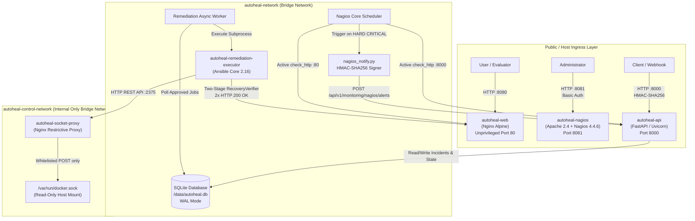

# AutoHeal — Nagios-Based Monitoring & Ansible-Driven Automated Remediation

**Technical Architecture, Implementation & Operations Manual**
**Technology Combination:** Ansible + Nagios (Streamlined 5-Container Architecture)
**Repository Branch:** `feature/automated-remediation`

---

## 1. Project Title and Overview

**AutoHeal** is an automated infrastructure monitoring, incident management, and policy-gated self-healing platform. It combines active health probing from **Nagios Core 4.4.6** with declarative, idempotent automated remediation playbooks executed via **Ansible Core 2.16**.

The two engines are unified by an asynchronous **FastAPI + SQLite (WAL mode)** control plane. The control plane authenticates incoming monitoring webhooks via constant-time HMAC-SHA256 tokens and request signatures, deduplicates alert notifications using deterministic SHA-256 event hashing, enforces fail-closed remediation policies (cooldown timers, attempt caps, service/action allowlists, and dry-run safety gates), coordinates recovery execution, and verifies sustained application health before resolving incidents.

All Docker daemon interactions occur through a hardened **Nginx Docker socket proxy** that restricts operations to an exact regex allowlist, mitigating direct host compromise risks by enforcing HTTP method, path, and container allowlists (bounding the inherent privileges of container restart capabilities).

---

## 2. Problem Statement

Modern microservice architectures and containerized deployments face two distinct operational vulnerabilities:

1. **Prolonged Mean Time to Recovery (MTTR) under Manual Intervention**: When monitoring systems detect a service disruption, human operators must be alerted, triage logs, diagnose failure causes, and manually apply remediations. In critical services, this operational delay translates to service unavailability, SLA violations, and business disruption.
2. **Security & Reliability Hazards of Naive Self-Healing Scripts**: Teams frequently attempt automated recovery by mounting `/var/run/docker.sock` directly into application containers, running unauthenticated webhook scripts, or relying on unrestricted Docker restart policies (`restart: always`). These approaches introduce severe risks:
   - **Infinite Crash Loops**: Containers failing due to persistent configuration or environmental defects repeatedly crash and restart, consuming host resources and obscuring root causes.
   - **Host Compromise via Privilege Escalation**: Mounting the raw Docker socket inside an application or monitoring container grants full root-equivalent access to the host kernel, exposing the infrastructure to container breakout.
   - **False Recovery Assurances**: Simple process restart commands report success as soon as the process launches, without validating whether the service is successfully serving HTTP traffic.

---

## 3. Objectives

- Implement continuous, active infrastructure and service health monitoring using **Nagios Core 4.4.6**.
- Implement declarative, idempotent remediation playbooks using **Ansible Core 2.16**.
- Bridge monitoring alerts and configuration management through a secure, fail-closed policy engine and incident coordinator.
- Enforce strict container security: zero direct Docker socket access on application, API, or monitoring containers.
- Restrict Docker API interactions through an isolated Nginx reverse proxy with path, method, and container name allowlists.
- Provide closed-loop verification: active health check $\rightarrow$ failure detection $\rightarrow$ incident creation $\rightarrow$ policy validation $\rightarrow$ Ansible recovery $\rightarrow$ two-stage health verification $\rightarrow$ incident resolution.
- Maintain a lean runtime footprint (measured typically between ~250–300 MiB total RAM across all 5 containers) with comprehensive automated regression test coverage (136 tests passing).

---

## 4. Technology Stack

| Layer | Technology | Version | Purpose |
| :--- | :--- | :--- | :--- |
| **Monitored Application** | Nginx (Alpine) | `nginx:alpine` | Web server exposing `/health` and status page |
| **Monitoring Engine** | Nagios Core | 4.4.6 | Active HTTP/TCP probing, state machine, webhook alerts |
| **Web Server / UI Gateway** | Apache HTTP Server | 2.4 (Debian) | Reverse proxy and HTTP Basic Auth for Nagios CGI/Web UI |
| **Control Plane & Policy** | FastAPI / Uvicorn | Python 3.12 (slim) | Alert ingestion, policy gating, REST API, state tracking |
| **State Persistence** | SQLite (WAL Mode) | 3.x | Persistent incident history, execution logs, WAL concurrency |
| **Configuration Engine** | Ansible Core | 2.16 (Python 3.12) | Idempotent playbook execution (`recover.yml`) |
| **Docker Gateway** | Nginx Proxy | `nginx:alpine` | Regex-based Docker API allowlist proxy |
| **Containerization** | Docker & Compose | Compose v2 | Dual-network container isolation and resource quotas |
| **Test Framework** | Pytest / AnyIO | pytest 8.4+ | Automated test suite (136 tests passing) |

---

## 5. Five-Container Architecture

AutoHeal decomposes responsibilities across five purpose-built containers communicating over isolated software-defined networks:

1. **`autoheal-web`**: The monitored production workload running unprivileged Nginx on port 8080. Exposes a static status page and an active JSON `/health` probe endpoint.
2. **`autoheal-nagios`**: Dedicated monitoring node hosting Nagios Core 4.4.6 and Apache 2.4. Executes scheduled active polling without agents inside target containers and invokes `nagios_notify.py` on state transitions.
3. **`autoheal-api`**: FastAPI-driven control plane and persistence coordinator. Authenticates incoming webhook events, records incidents, evaluates policy gates, and coordinates background workers.
4. **`autoheal-remediation-executor`**: Python 3.12 + Ansible Core 2.16 worker process. Dispatches allowlisted playbooks over an isolated TCP Docker API socket proxy without raw socket mounts.
5. **`autoheal-socket-proxy`**: Security boundary running Nginx. Intercepts Docker API requests from the executor, strictly enforcing path, method, and container allowlists before forwarding to `/var/run/docker.sock`.

---

## 6. Architecture Diagram



---

## 7. Complete Project Workflow

The autonomic self-healing lifecycle follows seven distinct stages: **Monitor $\rightarrow$ Detect $\rightarrow$ Analyze $\rightarrow$ Policy Evaluation $\rightarrow$ Execute $\rightarrow$ Verify $\rightarrow$ Resolve**.

```text
[Healthy Baseline]
       │
       ▼ (Failure Injected: container stopped or unhealthy)
[Nagios Active Check Fails] ──(1st & 2nd failure)──> [SOFT State: Retry interval 1s]
       │
       ▼ (3rd consecutive failure)
[HARD State Reached] ──> [Nagios Event Notification Triggered]
       │
       ▼ (nagios_notify.py dispatches HMAC-authenticated payload)
[FastAPI Ingests Webhook] ──> [Deterministic SHA-256 Deduplication Check]
       │
       ▼ (New problem event validated)
[Incident Created in SQLite] (status: open)
       │
       ▼
[Policy Evaluation Gate]
       ├── If disabled / dry-run / cooldown / max attempts reached ──> [Execution Blocked / Incident Remains Open]
       └── If approved ──> [Remediation Queued (status: pending)]
                                │
                                ▼
                   [Ansible Runner Invoked] (recover.yml via socket proxy)
                                │
                                ▼ (Container restarted via restricted proxy)
                   [Two-Stage Recovery Verification]
                                ├── Probe 1: HTTP 200 OK (passed)
                                └── Probe 2: HTTP 200 OK (confirmed sustained health)
                                         │
                                         ▼
                   [Incident Resolved] (status: resolved)
                                         │
                                         ▼
                   [Nagios Detects Recovery] (HARD OK notification dispatched)
```

1. **Monitor**: Nagios Core executes scheduled active probes against `autoheal-web` (`/health`) and `autoheal-api` (`/health`).
2. **Detect**: Transient failures enter `SOFT` state with 1-second retry intervals. If 3 consecutive checks fail, Nagios promotes the check to `HARD CRITICAL` (or `DOWN`).
3. **Analyze**: `nagios_notify.py` builds a deterministic payload with a SHA-256 deduplication key, signs the request using the shared HMAC secret, and posts it to FastAPI.
4. **Policy Evaluation**: FastAPI validates the signature, records the incident, and evaluates policy constraints (master enabled flag, dry-run mode, cooldown timer, attempt caps, and service/action allowlists).
5. **Execute**: The asynchronous executor picks up approved pending executions and invokes Ansible Core (`remediation/recover.yml`) targeting `autoheal-socket-proxy`.
6. **Verify**: Ansible exit code 0 alone does not resolve the incident. `RecoveryVerifier` independently probes the target URL (`http://web/health`), requiring 2 consecutive HTTP 200 OK responses.
7. **Resolve**: Upon verified recovery, the incident is updated to `resolved`. When Nagios confirms recovery, it dispatches a `RECOVERY` event that closes any remaining alert state.

---

## 8. Repository Structure

```text
/Users/deewakarkumar/Desktop/devops/AutoHeal/
├── .dockerignore                           # Build ignore filters for Docker images
├── .env.example                            # Safe default environment configuration template
├── .gitignore                              # Git tracking ignore rules
├── compose.yaml                            # 5-container Docker Compose service definition
├── README.md                               # Authoritative technical manual and documentation
├── ansible/                                # Supporting Ansible playbooks and inventory
│   ├── ansible.cfg                         # Ansible configuration (disable host key checking)
│   ├── inventory.ini                       # Local inventory mapping
│   ├── site.yml                            # Infrastructure verification playbook
│   └── webserver.yml                       # Web server configuration verification playbook
├── api/                                    # FastAPI control plane service
│   ├── Dockerfile                          # Multi-stage hardened Python image definition
│   ├── requirements.txt                    # FastAPI, Uvicorn, and Pydantic dependencies
│   └── src/
│       ├── config.py                       # Pydantic Settings configuration loader
│       ├── database.py                     # SQLite connection manager and health probes
│       ├── logging_config.py               # Structured single-line JSON logging formatter
│       ├── main.py                         # FastAPI application entrypoint and lifespan
│       ├── routes/                         # API routing controllers
│       │   ├── health.py                   # /health readiness check endpoint
│       │   ├── incidents.py                # /api/v1/incidents listing and detail endpoints
│       │   ├── nagios.py                   # /api/v1/monitoring/nagios webhook & status
│       │   ├── remediations.py             # /api/v1/remediations history & policy endpoints
│       │   └── status.py                   # /api/v1/status service monitoring endpoint
│       └── schemas/                        # Pydantic request and response schemas
│           ├── health.py                   # Health endpoint response schemas
│           ├── incident.py                 # Incident response models
│           ├── nagios.py                   # Nagios alert and probe schemas
│           ├── remediation.py              # Remediation execution and policy schemas
│           └── status.py                   # Monitored service status schemas
├── app/                                    # Monitored Nginx web application
│   ├── html/
│   │   └── index.html                      # Web frontend displaying live health status
│   └── nginx/
│       └── default.conf                    # Nginx server block with /health endpoint
├── data/
│   └── autoheal.db                         # Authoritative SQLite database (WAL mode)
├── docker/                                 # Custom Dockerfiles and proxy configuration
│   ├── ansible.Dockerfile                  # Ansible executor container definition
│   ├── nagios/
│   │   ├── Dockerfile                      # Debian-based Nagios Core 4.4.6 container
│   │   └── entrypoint.sh                   # Secrets rendering and pre-flight validation script
│   └── socket-proxy/
│       ├── Dockerfile                      # Minimal Nginx proxy container definition
│       └── nginx.conf                      # Whitelist-only Docker API restriction configuration
├── nagios/                                 # Nagios Core configuration tree
│   ├── etc/
│   │   ├── apache2-nagios.conf             # Hardened Apache VirtualHost for port 8081
│   │   ├── cgi.cfg.template                # CGI configuration template with auth enforcement
│   │   ├── nagios.cfg                      # Main Nagios Core configuration file
│   │   ├── resource.cfg                    # Macro definitions ($USER1$, $USER2$)
│   │   └── objects/                        # Nagios object definitions
│   │       ├── commands.cfg                # Check commands and notification commands
│   │       ├── contacts.cfg                # Webhook alert contact and contact group
│   │       ├── hosts.cfg                   # Monitored host definitions (web, api, nagios)
│   │       ├── services.cfg                # Monitored HTTP service definitions
│   │       ├── templates.cfg               # Base templates with check intervals and thresholds
│   │       └── timeperiods.cfg             # 24x7 monitoring time period
│   ├── nrpe/
│   │   ├── check_mem.py                    # Standalone memory utilization check plugin
│   │   └── nrpe.cfg                        # NRPE configuration definition
│   └── scripts/
│       └── nagios_notify.py                # HMAC-signed webhook notification dispatcher
├── remediation/                            # Remediation engine source code
│   ├── recover.yml                         # Idempotent Ansible container restart playbook
│   ├── requirements.txt                    # Remediation engine dependencies
│   └── src/
│       ├── ansible_runner.py               # Subprocess runner with argument validation
│       ├── config.py                       # Remediation policy configuration settings
│       ├── coordinator.py                  # Polling worker coordinating background tasks
│       ├── database.py                     # SQLite schema definitions and transaction helpers
│       ├── execution_manager.py            # Execution lifecycle and recovery coordination
│       ├── execution_models.py             # Internal dataclasses and execution schemas
│       ├── executor.py                     # Policy reservation and Ansible execution
│       ├── health_checker.py               # Asynchronous HTTP health checker
│       ├── incident_manager.py             # Incident deduplication and state transitions
│       ├── logging_config.py               # Shared JSON logging configuration
│       ├── metrics.py                      # Monitoring metrics registry
│       ├── metrics_store.py                # SQLite cumulative metrics recorder
│       ├── models.py                       # Incident and policy data models
│       ├── monitor.py                      # Background monitoring loop
│       ├── monitor_config.py               # Monitor configuration parameters
│       ├── nagios_models.py                # Nagios alert event models and outcome enums
│       ├── nagios_probe.py                 # External Nagios availability prober
│       ├── nagios_service.py               # Nagios alert processing and correlation service
│       ├── policy.py                       # Fail-closed remediation policy engine
│       ├── repository.py                   # Persistent SQLite remediation repository
│       ├── verifier.py                     # Two-stage post-remediation health verifier
│       └── worker.py                       # Background queue worker process
└── tests/                                  # Automated regression test suite
    ├── requirements.txt                    # Pytest dependencies
    ├── test_api.py                         # FastAPI endpoint integration tests
    ├── test_config.py                      # Configuration and environment validation tests
    ├── test_engine.py                      # Engine lifecycle and logging tests
    ├── test_health_checker.py              # HTTP health checker unit tests
    ├── test_incident_manager.py            # Incident transition and deduplication tests
    ├── test_nagios_alerts.py               # Nagios webhook, auth, and state handling tests
    ├── test_observability_config.py        # Nagios syntax, compose hardening, doc tests
    ├── test_remediation_config.py          # Remediation configuration validation tests
    ├── test_remediation_execution.py       # Ansible runner and execution manager tests
    ├── test_remediation_integration.py     # End-to-end remediation workflow tests
    ├── test_remediation_policy.py          # Policy engine rules and gate tests
    └── test_remediation_repository.py      # SQLite repository persistence and lock tests
```

---

## 9. Component Descriptions

| Container Name | Role | Primary Processes | Network Membership | Security Boundaries |
| :--- | :--- | :--- | :--- | :--- |
| `autoheal-web` | Production Monitored Web Target | Nginx (`nginx:alpine`) | `autoheal-network` | Read-only rootfs, tmpfs `/tmp`, `cap_drop: ALL`, unprivileged `uid=101` |
| `autoheal-api` | Control Plane & Policy Engine | Uvicorn / Python 3.12 (slim) | `autoheal-network` | Non-root `appuser (10001)`, read-only rootfs, tmpfs `/tmp`, WAL SQLite |
| `autoheal-nagios` | Active Monitoring & Alert Dispatcher | Nagios 4.4.6, Apache 2.4 (Debian) | `autoheal-network` | Hardened Apache on unprivileged port 8081, Basic Auth, isolated tmpfs secrets |
| `autoheal-socket-proxy` | Docker Daemon Gateway | Nginx (`nginx:alpine`) | `autoheal-control-network` | No host port exposure, URI regex whitelist, blocks container creation/deletion |
| `autoheal-remediation-executor` | Remediation Execution Engine | Python 3.12 (Alpine), Ansible Core 2.16 | `autoheal-network`, `autoheal-control-network` | Read-only workspace mount, no direct docker.sock, subprocess sandboxing |

---

## 10. Docker Compose Setup Instructions

### Prerequisites
- Docker Engine 24.0+ with Docker Compose v2.
- Python 3.11+ (for local test execution).
- Standard POSIX shell utilities (`curl`, `python3`).

### Step 1: Start the Five-Container Stack
```bash
docker compose up -d --wait
```

### Step 2: Verify Running Services and Health Status
```bash
docker compose ps
```
*Expected Output:* All 5 containers (`autoheal-web`, `autoheal-api`, `autoheal-nagios`, `autoheal-socket-proxy`, `autoheal-remediation-executor`) report state `Up (healthy)`.

### Step 3: Inspect Actual Resource Consumption
```bash
docker stats --no-stream --format "table {{.Name}}\t{{.CPUPerc}}\t{{.MemUsage}}\t{{.NetIO}}"
```
*Measured Runtime:* Combined memory usage across all 5 containers typically ranges between ~250–300 MiB (well below the cumulative 1,152 MiB hard allocation limits).

---

## 11. Environment Configuration Instructions

Configuration is managed via environment variables defined in `.env` (derived from [.env.example](file:///Users/deewakarkumar/Desktop/devops/AutoHeal/.env.example)).

### Key Configuration Variables

| Variable Name | Default Value | Description |
| :--- | :--- | :--- |
| `APP_PORT` | `8080` | Host port mapped to the `autoheal-web` application |
| `API_PORT` | `8000` | Host port mapped to the FastAPI control plane |
| `NAGIOS_PORT` | `8081` | Host port mapped to the Nagios Web UI |
| `AUTOHEAL_DB_PATH` | `/data/autoheal.db` | Absolute path to persistent SQLite database |
| `AUTOHEAL_REMEDIATION_ENABLED` | `false` | Master kill switch for automated remediation (**safe default**) |
| `AUTOHEAL_REMEDIATION_DRY_RUN` | `true` | When true, simulates Ansible execution without mutating state |
| `AUTOHEAL_REMEDIATION_COOLDOWN_SECONDS` | `300` | Minimum seconds between remediation attempts on the same service |
| `AUTOHEAL_REMEDIATION_MAX_ATTEMPTS` | `3` | Maximum retry attempts per incident before circuit breaker trips |
| `AUTOHEAL_REMEDIATION_TIMEOUT_SECONDS` | `120` | Maximum seconds allowed for an Ansible playbook execution |
| `AUTOHEAL_ALLOWED_SERVICES` | `web` | Comma-separated allowlist of services eligible for remediation |
| `AUTOHEAL_ALLOWED_ACTIONS` | `restart` | Comma-separated allowlist of approved remediation actions |
| `AUTOHEAL_REMEDIATION_VERIFY_ATTEMPTS` | `6` | Maximum health check polls during recovery verification |
| `AUTOHEAL_REMEDIATION_VERIFY_INTERVAL` | `5` | Seconds between recovery verification health probes |
| `AUTOHEAL_REMEDIATION_VERIFY_REQUIRED_SUCCESSES`| `2` | Required consecutive HTTP 200 OK responses to verify health |
| `NAGIOS_ADMIN_USER` | `nagiosadmin` | Administrative username for Nagios Core Web UI |
| `NAGIOS_ADMIN_PASSWORD` | *(set locally)* | Administrative password for Nagios Core Web UI |
| `AUTOHEAL_NAGIOS_WEBHOOK_SECRET` | *(set locally)* | Shared secret for HMAC-SHA256 webhook signature validation |

### Safe Local Secret Generation
Ensure `.env` contains valid secrets without exposing values in shell history:
```bash
python3 -c "
import secrets, re
admin_pass = secrets.token_urlsafe(16)
webhook_secret = secrets.token_hex(24)
content = open('.env').read() if open('.env').readable() else open('.env.example').read()
content = re.sub(r'NAGIOS_ADMIN_PASSWORD=.*', f'NAGIOS_ADMIN_PASSWORD={admin_pass}', content)
content = re.sub(r'AUTOHEAL_NAGIOS_WEBHOOK_SECRET=.*', f'AUTOHEAL_NAGIOS_WEBHOOK_SECRET={webhook_secret}', content)
open('.env', 'w').write(content)
print('Configured local secrets securely in .env')
"
```

---

## 12. Nagios Monitoring Configuration

Nagios Core 4.4.6 runs in `autoheal-nagios` and actively polls monitored services using unprivileged TCP and HTTP plugins:

- **Host Checks**: Defined in `nagios/etc/objects/hosts.cfg`. Checks target TCP ports (e.g. `check_tcp_port!80`) to avoid requiring raw ICMP sockets.
- **Service Checks**: Defined in `nagios/etc/objects/services.cfg`. Uses `check_http_endpoint!80!/health` with `max_check_attempts 3`, `check_interval 1`, and `retry_interval 1`.
- **Notification Commands**: Defined in `nagios/etc/objects/commands.cfg`. Dispatches alerts to `nagios_notify.py` over an internal HTTP POST.
- **Runtime Log Path**: Active daemon logs are maintained at `/tmp/nagios4/nagios.log`.

### Pre-Flight Configuration Verification
Validate Nagios object definitions inside the container:
```bash
docker exec autoheal-nagios /usr/sbin/nagios4 -v /opt/nagios/etc/nagios.cfg
```
*Expected Output:*
```text
Total Warnings: 0
Total Errors:   0
Things look okay - No serious problems were detected during the pre-flight check
```

---

## 13. FastAPI Endpoints and Webhook Authentication

The FastAPI control plane exposes the following REST endpoints on port 8000:

| HTTP Method | Path | Description | Authentication |
| :--- | :--- | :--- | :--- |
| `GET` | `/health` | Control plane readiness and SQLite health check | None |
| `GET` | `/api/v1/status` | Current monitoring status for target service | None |
| `GET` | `/api/v1/incidents` | List recorded incidents (filterable by status/service) | None |
| `GET` | `/api/v1/incidents/{id}` | Detailed record of a specific incident | None |
| `GET` | `/api/v1/remediations` | Paginated remediation history and outcomes | None |
| `GET` | `/api/v1/remediations/{id}` | Detailed execution record including output | None |
| `GET` | `/api/v1/remediations/status`| Remediation summary statistics and counts | None |
| `GET` | `/api/v1/remediations/policies`| Read-only remediation policy constraints | None |
| `POST`| `/api/v1/monitoring/nagios/alerts`| Webhook ingestion endpoint for Nagios alerts (supports `/alert` alias) | **HMAC-SHA256 Token or Signature Required** |
| `GET` | `/api/v1/monitoring/nagios/events`| Ingested Nagios notification event history | None |
| `GET` | `/api/v1/monitoring/nagios/status`| Nagios Core integration status and probe data | None |

### Webhook Authentication Protocol
- Dispatched webhooks must provide either:
  1. A shared secret token in `X-Nagios-Token`, `X-AutoHeal-Signature`, or `Authorization: Bearer <secret>`.
  2. An HMAC-SHA256 hex digest signature computed over the raw request payload (`sha256=<hex>` or raw `<hex>`).
- Signature comparison is evaluated in constant time using `hmac.compare_digest` to prevent timing attacks.
- Requests with missing or invalid tokens/signatures are rejected with `HTTP 401 Unauthorized` without creating database records.

---

## 14. Ansible Automated Remediation Workflow

The remediation playbook is located at `remediation/recover.yml`. It is executed inside `autoheal-remediation-executor` with strict variable assertions:

```yaml
- name: AutoHeal isolated recovery workflow
  hosts: local
  gather_facts: false

  vars:
    autoheal_target_service: "web"
    autoheal_action: "restart"
    allowed_services:
      - web
    allowed_actions:
      - restart
      - start
    target_container_name: "autoheal-{{ autoheal_target_service }}"

  tasks:
    - name: Validate remediation target service and action against fixed allowlists
      ansible.builtin.assert:
        that:
          - autoheal_target_service is string
          - autoheal_action is string
          - autoheal_target_service in allowed_services
          - autoheal_action in allowed_actions
        fail_msg: >-
          Rejected unapproved target_service='{{ autoheal_target_service }}'
          or action='{{ autoheal_action }}'.
        success_msg: >-
          Validated remediation request for container '{{ target_container_name }}'
          with action '{{ autoheal_action }}'.

    - name: Inspect current container state via restricted Docker endpoint
      ansible.builtin.command:
        argv:
          - docker
          - inspect
          - --format={{ '{{' }}.State.Status{{ '}}' }}
          - "{{ target_container_name }}"
      register: container_inspect
      check_mode: false
      changed_when: false

    - name: Verify inspected state is non-empty
      ansible.builtin.assert:
        that:
          - (container_inspect.stdout | trim) | length > 0
        fail_msg: "Unable to determine Docker state for {{ target_container_name }}."

    - name: Execute approved container restart action
      ansible.builtin.command:
        argv:
          - docker
          - restart
          - "{{ target_container_name }}"
      register: restart_cmd
      when:
        - autoheal_action == "restart"
        - not ansible_check_mode
      changed_when: true

    - name: Execute approved container start action
      ansible.builtin.command:
        argv:
          - docker
          - start
          - "{{ target_container_name }}"
      register: start_cmd
      when:
        - autoheal_action == "start"
        - (container_inspect.stdout | trim) != "running"
        - not ansible_check_mode
      changed_when: true

    - name: Inspect post-action container state
      ansible.builtin.command:
        argv:
          - docker
          - inspect
          - --format={{ '{{' }}.State.Status{{ '}}' }}
          - "{{ target_container_name }}"
      register: post_inspect
      check_mode: false
      changed_when: false

    - name: Confirm container entered running state when not in check mode
      ansible.builtin.assert:
        that:
          - (post_inspect.stdout | trim) == "running"
        fail_msg: >-
          Container '{{ target_container_name }}' state after '{{ autoheal_action }}'
          is '{{ post_inspect.stdout | trim }}' (expected 'running').
      when: not ansible_check_mode

    - name: Report structured Ansible execution summary
      ansible.builtin.debug:
        msg: >-
          target={{ target_container_name }} action={{ autoheal_action }}
          check_mode={{ ansible_check_mode }}
          initial_state={{ container_inspect.stdout | trim }}
          post_state={{ post_inspect.stdout | trim }}
```

### Safety Features
- **Strict Whitelist Assertions**: Rejects any parameter override outside `allowed_services` (`web`) and `allowed_actions` (`restart`, `start`).
- **Dry-Run Check Mode**: Supports `--check` mode (`ansible_check_mode`), validating prerequisites without mutating container state.
- **Closed-Loop Verification**: Ansible exit code 0 alone does not resolve an incident. `RecoveryVerifier` must receive the configured consecutive HTTP 200 OK responses before marking the incident resolved.

---

## 15. Restricted Docker Socket Proxy and Security Controls

AutoHeal implements Defense-in-Depth across multiple operational layers:

1. **Docker Socket Proxy Gateway**:
   - The Docker socket (`/var/run/docker.sock`) is mounted **only** to `autoheal-socket-proxy` in read-only mode (`:ro`).
   - *Security Scope & Limitations:* A read-only bind mount of a Docker Unix socket on the host filesystem level (`:ro`) protects the socket inode itself from deletion or replacement inside the container namespace, but standard Docker API operations over the socket (such as `POST /containers/.../restart`) still instruct the host Docker daemon to mutate container runtime states.
   - Genuine security isolation relies on Nginx reverse proxy filtering (`docker/socket-proxy/nginx.conf`), which strictly permits only the minimal operations required for remediation:
     - `GET /_ping` $\rightarrow$ Allowed (healthcheck and engine ping)
     - `GET /version` $\rightarrow$ Allowed (engine API version negotiation)
     - `GET /containers/autoheal-web/json` $\rightarrow$ Allowed (target container state inspection)
     - `POST /containers/autoheal-web/restart` $\rightarrow$ Allowed (approved restart)
     - `POST /containers/autoheal-web/start` $\rightarrow$ Allowed (approved start)
     - Strict path normalization rejects URL traversal (`..`), double slashes (`//`), backslashes (`\`), semicolons (`;`), query strings (`?`), and URL-encoded characters (`%`).
     - All other Docker API operations (including container creation, deletion, image pulling, volume/network manipulation, exec, and operations targeting `autoheal-api`, `autoheal-nagios`, or host) return **HTTP 403 Forbidden**.
   - Note: While the proxy substantially mitigates container escape risks compared to direct socket exposure, any proxy granting container restart privileges retains bounded authority that must be restricted to internal networks.
2. **Network Segmentation**:
   - `autoheal-network`: Bridge network connecting user traffic, web, API, and Nagios.
   - `autoheal-control-network`: Internal, non-routable bridge network (`internal: true`) connecting only `autoheal-remediation-executor` to `autoheal-socket-proxy`.
3. **Webhook Authentication**:
   - Validated via constant-time `hmac.compare_digest` against shared secrets or computed request digests.
4. **Least-Privilege Containerization**:
   - All containers run with `security_opt: [no-new-privileges:true]`.
   - Linux capabilities are dropped (`cap_drop: [ALL]`).
   - Monitored application, API, and executor run as unprivileged non-root users (`uid=101`, `uid=10001`).
   - Root filesystems are mounted read-only (`read_only: true`) with ephemeral `/tmp` tmpfs mounts.

---

## 16. SQLite Persistence

State is persisted in `/data/autoheal.db` using SQLite with Write-Ahead Logging (WAL) enabled:

### Schema Overview
- **`incidents`**: Records failure incidents with timestamps, source (`internal_monitor` or `nagios`), severity, failure count, and resolution timestamps.
  - Partial unique index: `uq_incidents_open_service ON incidents (service_name) WHERE status = 'open'`. Ensures only one open incident per service.
- **`remediation_executions`**: Audit trail of every remediation attempt, including target service, action, status (`pending`, `running`, `succeeded`, `failed`, `dry_run`, `timed_out`), Ansible exit code, duration, and output.
  - Partial unique index: `uq_remediation_active_incident ON remediation_executions (incident_id) WHERE status IN ('pending', 'running')`.
  - Composite unique index: `uq_remediation_incident_attempt ON remediation_executions (incident_id, attempt_number)`.
- **`nagios_events`**: Audit log of all ingested Nagios webhook events with deterministic `dedup_key` preventing duplicate processing.
- **`service_status`**: Current operational status and health metrics of monitored services.
- **`nagios_monitor_status`**: Live availability probe state of the Nagios Core daemon.
- **`remediation_exhausted_incidents`**: Circuit-breaker record of incidents that reached maximum retry attempts.
- **`remediation_schema_meta`**: Migration and schema version tracking metadata.
- **`monitoring_counters`, `remediation_counters`, `nagios_counters`**: In-database telemetry and event metrics.

### Concurrency Guarantees
- SQLite `PRAGMA journal_mode=WAL;` allows concurrent readers without blocking writers.
- `BEGIN IMMEDIATE` transactions serialize writes, preventing race conditions during concurrent alert bursts.

---

## 17. Testing Instructions and Actual Test Results

The repository contains an automated test suite providing comprehensive unit, integration, and security test coverage.

### Run the Full Test Suite
```bash
PYTHONPATH=. .venv/bin/pytest -v
```

### Actual Test Execution Results
```text
============================= test session starts ==============================
platform darwin -- Python 3.14.7, pytest-8.4.2
rootdir: /Users/deewakarkumar/Desktop/devops/AutoHeal
collected 136 items

tests/test_api.py ..................................................... [  3%]
tests/test_config.py .................................................. [ 18%]
tests/test_engine.py .................................................. [ 20%]
tests/test_health_checker.py .......................................... [ 23%]
tests/test_incident_manager.py ........................................ [ 25%]
tests/test_nagios_alerts.py ........................................... [ 33%]
tests/test_observability_config.py .................................... [ 36%]
tests/test_remediation_config.py ...................................... [ 44%]
tests/test_remediation_execution.py ................................... [ 63%]
tests/test_remediation_integration.py ................................. [ 80%]
tests/test_remediation_policy.py ...................................... [ 88%]
tests/test_remediation_repository.py .................................. [100%]

====================== 136 passed, 173 warnings in 4.48s =======================
```

### Ansible Playbook Syntax Checks
```bash
docker exec autoheal-remediation-executor ansible-playbook --syntax-check \
  /workspace/remediation/recover.yml \
  /workspace/ansible/site.yml \
  /workspace/ansible/webserver.yml
```

---

## 18. Live Demonstration Procedure

To observe the automated self-healing loop in a controlled 5–7 minute evaluation:

### Step 1: Confirm Initial Baseline Health
```bash
curl -s http://127.0.0.1:8080/health
# Returns: {"status": "healthy", "service": "web"}
```

### Step 2: Temporarily Enable Live Remediation
```bash
python3 -c "
content = open('.env').read()
content = content.replace('AUTOHEAL_REMEDIATION_ENABLED=false', 'AUTOHEAL_REMEDIATION_ENABLED=true')
content = content.replace('AUTOHEAL_REMEDIATION_DRY_RUN=true', 'AUTOHEAL_REMEDIATION_DRY_RUN=false')
open('.env', 'w').write(content)
"
docker compose up -d api remediation-executor
```

### Step 3: Inject Failure by Stopping Monitored Container
```bash
docker stop autoheal-web
```

### Step 4: Observe Nagios Detection
```bash
docker exec autoheal-nagios tail -n 15 /tmp/nagios4/nagios.log
```
Nagios transitions `autoheal-web` from SOFT to HARD CRITICAL and executes `notify-service-autoheal`.

### Step 5: Observe Webhook Receipt and Incident Creation
```bash
curl -s http://127.0.0.1:8000/api/v1/incidents | jq .
```
FastAPI creates an open incident and queues an approved remediation task.

### Step 6: Observe Ansible Recovery and Socket Proxy Interaction
```bash
docker logs autoheal-remediation-executor --tail 25
```
The executor runs `recover.yml`, issues `POST /containers/autoheal-web/restart` via `autoheal-socket-proxy`, and invokes `RecoveryVerifier`.

### Step 7: Confirm Service Recovery and Incident Resolution
```bash
curl -s http://127.0.0.1:8080/health
# Returns: {"status": "healthy", "service": "web"}

curl -s http://127.0.0.1:8000/api/v1/incidents | jq .
# Incident transitions to status: "resolved"
```

### Step 8: Restore Safe Defaults
```bash
python3 -c "
content = open('.env').read()
content = content.replace('AUTOHEAL_REMEDIATION_ENABLED=true', 'AUTOHEAL_REMEDIATION_ENABLED=false')
content = content.replace('AUTOHEAL_REMEDIATION_DRY_RUN=false', 'AUTOHEAL_REMEDIATION_DRY_RUN=true')
open('.env', 'w').write(content)
"
docker compose up -d api remediation-executor
```

---

## 19. Troubleshooting

### Issue 1: Webhook Returns HTTP 401 Unauthorized
- **Cause**: The HMAC secret sent by `nagios_notify.py` does not match `AUTOHEAL_NAGIOS_WEBHOOK_SECRET` in the API container.
- **Resolution**: Verify that `AUTOHEAL_NAGIOS_WEBHOOK_SECRET` is identical in `.env` and restart containers (`docker compose up -d api nagios`).

### Issue 2: Remediation Executor Reports HTTP 403 Forbidden
- **Cause**: An unapproved Docker operation was attempted against `autoheal-socket-proxy`.
- **Resolution**: Check the URI path requested by Ansible. The socket proxy permits only `GET /_ping`, `GET /version`, `GET /containers/autoheal-web/json`, `POST /containers/autoheal-web/restart`, and `POST /containers/autoheal-web/start`.

### Issue 3: Nagios Reports Host DOWN during Container Outage
- **Cause**: When a Docker container stops, Docker DNS temporarily removes the container's IP (`Name or service not known` or `Invalid hostname, address or socket: web`).
- **Resolution**: Expected behavior during a container outage. Nagios `check_http` and `check_tcp` fail and trigger notification. Once restarted by Ansible, DNS resolution is restored and Nagios marks the host and service UP / OK.

### Issue 4: Incident Remains in Open / Remediating State
- **Cause**: The container was restarted, but the application failed post-remediation health checks.
- **Resolution**: Check application logs (`docker logs autoheal-web`). The `RecoveryVerifier` requires 2 consecutive HTTP 200 OK responses to mark the incident resolved. Ansible exit code 0 alone does not resolve an incident.

---

## 20. Known Limitations and Future Improvements

1. **Single-Target Remediation Scope**: By design, the Docker socket proxy allowlist is locked strictly to `autoheal-web`. Extending automated remediation to additional services requires explicitly updating `docker/socket-proxy/nginx.conf` to maintain least-privilege boundaries.
2. **Single-Node Deployment**: The SQLite database and Docker socket proxy are engineered for single-host deployments. Distributed multi-node orchestration would require an external database (e.g., PostgreSQL) and cluster orchestration (e.g., Kubernetes).
3. **Unauthenticated Read-Only API Endpoints**: Read-only `GET` endpoints in FastAPI are unauthenticated under the assumption that the control plane operates inside an internal perimeter. Production deployments should enforce API gateway authentication.

---

## 21. Safe Shutdown and Cleanup Instructions

### Routine Shutdown (Preserving Persistent Database State)
```bash
docker compose down
```

### Volume Reset (Destructive)

> [!WARNING]
> Do NOT use `docker compose down -v` for routine shutdown or maintenance. The `-v` flag deletes named Docker volumes (such as `nagios-data`) and may destroy persistent state. Use `docker compose down` instead to preserve database and service state.

```bash
docker compose down -v
```

### Clean Python Bytecode and Test Caches
```bash
find . -type d -name "__pycache__" -exec rm -rf {} + 2>/dev/null || true
rm -rf .pytest_cache
```
