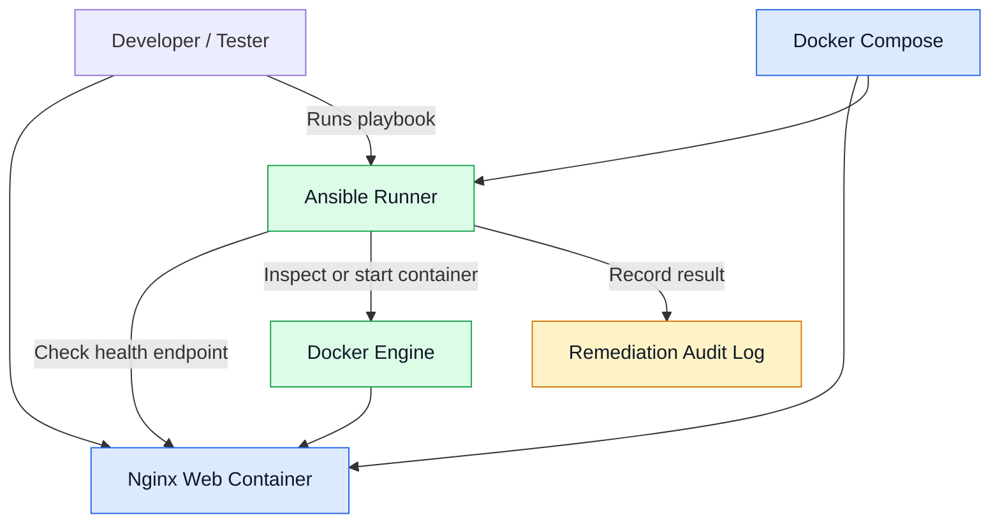

# AutoHeal — Self-Healing Infrastructure Automation

AutoHeal is a DevOps project that demonstrates how infrastructure automation can detect service failures, execute recovery actions, verify service health, and record remediation outcomes.

The current prototype uses Docker Compose, Nginx, and Ansible to implement and test a basic self-healing workflow locally.

## Features

- Containerized environment using Docker Compose.
- Nginx web server with a dedicated health endpoint.
- Ansible-based infrastructure and service validation.
- Recovery of stopped containers.
- Post-recovery health verification.
- Basic remediation audit logging.
- Controlled failure simulation and recovery testing.

## Architecture



See [docs/architecture.md](docs/architecture.md) for the detailed recovery workflow.

## Technology Stack

| Technology | Purpose |
|---|---|
| Docker | Container runtime |
| Docker Compose | Local service orchestration |
| Nginx | Web server and health endpoint |
| Ansible | Validation and remediation |
| YAML | Configuration and playbooks |
| Git and GitHub | Version control |

## Project Structure

```text
AutoHeal/
├── app/
│   ├── html/index.html
│   └── nginx/default.conf
├── ansible/
│   ├── ansible.cfg
│   ├── inventory.ini
│   ├── site.yml
│   └── webserver.yml
├── docker/ansible.Dockerfile
├── remediation/recover.yml
├── docs/architecture.md
├── compose.yaml
├── .gitignore
└── README.md
```

## Prerequisites

- Docker Desktop installed and running.
- Git installed.

## Getting Started

### 1. Clone the repository

```bash
git clone https://github.com/deewakar05/AutoHeal.git
cd AutoHeal
```

### 2. Start the application

```bash
docker compose up -d --build
```

### 3. Verify the web application

Open http://localhost:8080 or run:

```bash
curl -i http://localhost:8080/health
```

Expected response:

```text
HTTP/1.1 200 OK

healthy
```

### 4. Validate using Ansible

```bash
docker compose exec ansible ansible-playbook site.yml
docker compose exec ansible ansible-playbook webserver.yml
```

### 5. Run the recovery playbook

```bash
docker compose exec ansible ansible-playbook ../remediation/recover.yml
```

### 6. Test a stopped-container failure

Stop the web container:

```bash
docker stop autoheal-web
```

Run the recovery playbook again:

```bash
docker compose exec ansible ansible-playbook ../remediation/recover.yml
```

Verify recovery:

```bash
curl -i http://localhost:8080/health
cat logs/remediation.log
```

### 7. Stop the environment

```bash
docker compose down
```

## Testing Results

The local prototype has successfully demonstrated:

- Application and health endpoint availability.
- Successful Ansible validation.
- Recovery after deliberately stopping the web container.
- Successful post-recovery HTTP health verification.
- Recording health and recovery outcomes in an audit log.

## Current Limitations

- Recovery is triggered manually by running the Ansible playbook.
- Monitoring-driven failure detection and automatic event triggering are not implemented yet.
- Recovery rate limits and escalation remain future improvements.
- Audit logs are basic and stored locally.
- Cloud infrastructure recovery has not yet been validated.

## Future Enhancements

- Prometheus and Alertmanager integration.
- Webhook-triggered remediation.
- Recovery rate limiting and failure escalation.
- Grafana dashboards for monitoring and recovery metrics.
- Terraform and AWS integration.
- Automated testing and CI/CD.

## Security

The Ansible runner mounts the Docker socket to control local containers. This grants extensive control over the Docker environment. Keep this setup restricted to a trusted development environment and never expose the socket or runner to untrusted users.

## Project Status

The local recovery prototype is working. Automated monitoring triggers, additional safety controls, and cloud integration remain planned improvements.

## Author

**Deewakar Kumar**

GitHub: [@deewakar05](https://github.com/deewakar05)

Repository: [AutoHeal](https://github.com/deewakar05/AutoHeal)
