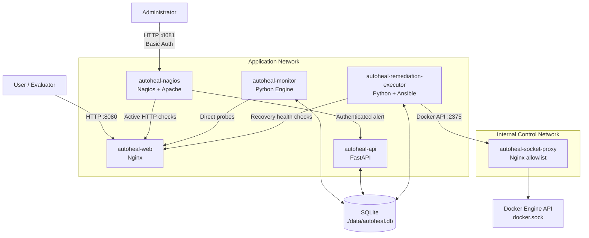

# AutoHeal — Nagios Monitoring and Ansible-Based Automated Remediation

- **Technology:** Nagios + Ansible
- **Repository:** [deewakar05/AutoHeal](https://github.com/deewakar05/AutoHeal)
- **Default branch:** `main`

AutoHeal is a containerized infrastructure-monitoring and self-healing prototype. It monitors a web service, receives authenticated monitoring alerts, applies remediation policy checks, runs an Ansible recovery playbook through a restricted Docker API proxy, and verifies application health before an incident is marked resolved.

**Project scope:** AutoHeal demonstrates a controlled, single-host recovery workflow. It is an academic/engineering prototype, not a claim of production-grade multi-node orchestration.

---

## Contents

1. [Problem and objectives](#1-problem-and-objectives)
2. [Technology stack](#2-technology-stack)
3. [Architecture](#3-architecture)
4. [Recovery workflow](#4-recovery-workflow)
5. [Services and responsibilities](#5-services-and-responsibilities)
6. [Repository layout](#6-repository-layout)
7. [Prerequisites and installation](#7-prerequisites-and-installation)
8. [Configuration and safety defaults](#8-configuration-and-safety-defaults)
9. [API interfaces](#9-api-interfaces)
10. [Security design](#10-security-design)
11. [Persistence](#11-persistence)
12. [Testing and validation](#12-testing-and-validation)
13. [Demonstration procedure](#13-demonstration-procedure)
14. [Troubleshooting](#14-troubleshooting)
15. [Limitations](#15-limitations)
16. [Shutdown and cleanup](#16-shutdown-and-cleanup)

---

## 1. Problem and objectives

When a service becomes unavailable, an operator normally has to detect the alert, investigate the failure, perform a recovery action, and confirm that the service is healthy again. This manual process can increase recovery time.

A basic restart script is not sufficient: it may restart the wrong target, repeat indefinitely, expose excessive Docker privileges, or report success even when the application remains unhealthy.

AutoHeal demonstrates a controlled alternative:
- Monitor the target application using Nagios.
- Receive and authenticate monitoring notifications through FastAPI.
- Record and deduplicate incidents.
- Evaluate remediation policies before execution.
- Execute an allowlisted Ansible playbook through a restricted Docker API proxy.
- Verify application health after the recovery action.
- Resolve incidents only after successful verification.

---

## 2. Technology stack

| Component | Technology | Purpose |
| :--- | :--- | :--- |
| **Monitored application** | Nginx Alpine | Serves the demo application and health endpoint |
| **Monitoring** | Nagios Core 4.4.6 | Active checks and notifications |
| **Monitoring interface** | Apache HTTP Server | Nagios web interface |
| **Control plane** | FastAPI, Uvicorn, Python | Alert ingestion and incident coordination |
| **Persistence** | SQLite with WAL | Incident and execution history |
| **Remediation** | Ansible Core 2.16 | Executes recovery playbooks |
| **Docker API boundary** | Nginx socket proxy | Restricts Docker API operations |
| **Container runtime** | Docker Compose v2 | Service orchestration |
| **Testing** | pytest | Unit and integration testing |

> Refer to the Dockerfiles and dependency files for the exact versions used by the current checkout.

---

## 3. Architecture

AutoHeal uses containerized services orchestrated via Docker Compose. The API, web application, Nagios, dedicated monitor, and remediation executor communicate through the application network. The executor also connects to a separate internal control network containing the Docker socket proxy.



---

## 4. Recovery workflow

The intended lifecycle is:

$$\text{Monitor} \longrightarrow \text{Detect} \longrightarrow \text{Notify} \longrightarrow \text{Record} \longrightarrow \text{Evaluate Policy} \longrightarrow \text{Execute} \longrightarrow \text{Verify} \longrightarrow \text{Resolve}$$

- **Monitor**: Nagios periodically checks the web application and configured services.
- **Detect**: Failed checks move through Nagios SOFT/HARD states according to the configured retry policy.
- **Notify**: A qualifying state transition triggers the Nagios notification script.
- **Record**: FastAPI authenticates and deduplicates the notification, then records the incident.
- **Evaluate policy**: The remediation engine checks the master enable flag, dry-run setting, allowed service/action, cooldown, and attempt limits.
- **Execute**: Approved work is passed to the Ansible executor. Docker operations go through the restricted socket proxy.
- **Verify**: The recovery verifier checks the application health endpoint and requires consecutive successful responses.
- **Resolve**: The incident is marked resolved only after successful verification.

> **Important**: An Ansible exit code of zero or a running container does not independently prove that the application has recovered.

---

## 5. Services and responsibilities

| Compose service | Container name | Responsibility |
| :--- | :--- | :--- |
| `web` | `autoheal-web` | Monitored Nginx application |
| `nagios` | `autoheal-nagios` | Active monitoring and notifications |
| `monitor` | `autoheal-monitor` | Dedicated asynchronous health probe and metric engine |
| `api` | `autoheal-api` | Webhook validation, incident API, policy coordination |
| `remediation-executor` | `autoheal-remediation-executor` | Background Ansible execution |
| `docker-socket-proxy` | `autoheal-socket-proxy` | Restricted Docker API gateway |

> The authoritative service definitions, networks, ports, health checks, mounts, and resource limits are in `compose.yaml`.

---

## 6. Repository layout

```text
.
├── ansible/                # Supporting Ansible configuration and playbooks
├── api/
│   └── src/                # FastAPI application, routes, schemas and configuration
├── app/
│   ├── html/               # Monitored web page
│   └── nginx/              # Nginx configuration and health endpoint
├── docker/
│   ├── nagios/             # Nagios image and entrypoint
│   └── socket-proxy/       # Docker API proxy configuration
├── nagios/
│   ├── etc/                # Nagios core and object configuration
│   ├── nrpe/               # Check plugin/configuration files
│   └── scripts/            # Nagios notification dispatcher
├── remediation/
│   ├── recover.yml         # Authoritative recovery playbook
│   └── src/                # Policy, execution, worker, repository and verifier
├── tests/                  # Automated tests
├── compose.yaml            # Five-service Compose configuration
├── .env.example            # Environment configuration template
└── README.md
```

> Runtime data is stored under `data/` and excluded from version control.

---

## 7. Prerequisites and installation

### Prerequisites
- Docker Engine or Docker Desktop
- Docker Compose v2
- Git
- Python 3.11 or newer for host-side tests

### Step 1: Clone the repository
```bash
git clone https://github.com/deewakar05/AutoHeal.git
cd AutoHeal
```

### Step 2: Create local configuration
Generate unique credentials locally. The generated values are written to `.env` and are not printed.

```bash
python3 - <<'PY'
from pathlib import Path
import secrets

template = Path(".env.example").read_text()
template = template.replace(
    "NAGIOS_ADMIN_PASSWORD=change-me-local-nagios-admin",
    f"NAGIOS_ADMIN_PASSWORD={secrets.token_urlsafe(24)}",
)
template = template.replace(
    "AUTOHEAL_NAGIOS_WEBHOOK_SECRET=change-me-local-nagios-webhook-secret",
    f"AUTOHEAL_NAGIOS_WEBHOOK_SECRET={secrets.token_hex(32)}",
)

env_file = Path(".env")
env_file.write_text(template)
env_file.chmod(0o600)
print("Created .env with locally generated credentials.")
PY
```

> Never commit `.env` or publish its contents.

### Step 3: Validate and start the stack
```bash
docker compose config -q
docker compose up -d --build --wait
docker compose ps
```
Wait for the containers to pass their health checks.

### Step 4: Check application endpoints
```bash
curl -i http://127.0.0.1:8080/health
curl -i http://127.0.0.1:8000/health
```

Default host ports:

| Service | Port |
| :--- | :--- |
| Web application | `8080` |
| FastAPI | `8000` |
| Nagios web interface | `8081` |

Nagios interface:
```
http://127.0.0.1:8081/nagios4/
```
Use the locally configured Nagios credentials.

---

## 8. Configuration and safety defaults

The main configuration template is `.env.example`. The Compose file defines additional defaults.

Important settings:

| Variable | Default | Description |
| :--- | :--- | :--- |
| `AUTOHEAL_REMEDIATION_ENABLED` | `false` | Master remediation switch |
| `AUTOHEAL_REMEDIATION_DRY_RUN` | `true` | Enables dry-run mode |
| `AUTOHEAL_REMEDIATION_COOLDOWN_SECONDS` | `300` | Minimum cooldown between attempts |
| `AUTOHEAL_REMEDIATION_MAX_ATTEMPTS` | `3` | Maximum remediation attempts |
| `AUTOHEAL_ALLOWED_SERVICES` | `web` | Allowed target services |
| `AUTOHEAL_ALLOWED_ACTIONS` | `restart` | Allowed recovery actions |
| `AUTOHEAL_REMEDIATION_VERIFY_TARGET_URL` | `http://web/health` | Recovery verification endpoint |
| `AUTOHEAL_REMEDIATION_VERIFY_REQUIRED_SUCCESSES` | `2` | Required consecutive successful probes |

Other settings control ports, database location, timeouts, executor polling, Nagios integration, and logging.

Keep these values for normal operation:
```env
AUTOHEAL_REMEDIATION_ENABLED=false
AUTOHEAL_REMEDIATION_DRY_RUN=true
```

> Live remediation can restart the allowlisted target container. Enable it only for a controlled test environment.

---

## 9. API interfaces

The API is exposed at `http://127.0.0.1:8000` by default.

| Method | Endpoint | Purpose |
| :--- | :--- | :--- |
| `GET` | `/health` | API health check |
| `GET` | `/api/v1/status` | Service/monitoring status |
| `GET` | `/api/v1/incidents` | List incidents |
| `GET` | `/api/v1/incidents/{id}` | Retrieve an incident |
| `GET` | `/api/v1/remediations` | List remediation executions |
| `GET` | `/api/v1/remediations/{id}` | Retrieve an execution |
| `GET` | `/api/v1/remediations/status` | Remediation summary |
| `GET` | `/api/v1/remediations/policies` | Read policy constraints |
| `POST` | `/api/v1/monitoring/nagios/alerts` | Receive Nagios alerts |
| `GET` | `/api/v1/monitoring/nagios/events` | Review Nagios events |
| `GET` | `/api/v1/monitoring/nagios/status` | Nagios integration status |

The Nagios webhook requires the configured shared secret or a valid HMAC-SHA256 signature. Nagios and FastAPI must use the same secret. Invalid authentication is rejected.

Read-only API routes are not a replacement for public API authentication. Keep the control plane on a trusted network unless additional access controls are implemented.

For exact request and response schemas, inspect the route and schema modules under `api/src/`.

---

## 10. Security design

AutoHeal uses multiple restrictions:
- **Webhook authentication**: Nagios notifications are authenticated using a shared secret or HMAC-SHA256 signature. Signature comparisons use constant-time comparison.
- **Policy enforcement**: Remediation is disabled by default and subject to dry-run, service/action allowlists, cooldowns, and attempt limits.
- **Docker API proxy**: The executor accesses Docker through the Nginx proxy, whose rules restrict permitted methods, paths, and target container.
- **Network isolation**: The socket proxy is attached to the internal control network. The executor is the component that connects the application and control networks.
- **Container hardening**: Compose configures read-only filesystems, dropped capabilities, no-new-privileges, tmpfs mounts, and resource limits where defined.
- **Audit history**: Incidents and remediation executions are stored in SQLite.

### Important Docker socket caveat
Mounting `/var/run/docker.sock` into the proxy with `:ro` does not make Docker API operations read-only.

A read-only bind mount protects the mounted filesystem entry from being replaced through that mount. It does not prevent the Docker daemon from performing a mutating operation requested through the API.

The actual security boundary is the proxy's allowlist and network exposure. The proxy retains authority to perform the Docker operations it permits. Keep it isolated and review its rules before making changes.

### Security scope
This is a single-host demonstration system. The proxy, Docker daemon, host, secrets, and application remain part of the trusted computing boundary.

A production deployment would require a broader threat model, stronger API authorization, external secret management, monitoring of the control plane, and independent security review.

---

## 11. Persistence

The API and remediation executor use the configured database path, defaulting to `/data/autoheal.db`.

Compose mounts the local `./data` directory at `/data`, so database state persists across container recreation.

SQLite uses Write-Ahead Logging (WAL). The database stores operational information such as incidents, Nagios events, and remediation execution history.

Nagios also uses the named `nagios-data` volume.

> Do not commit SQLite database, WAL, or SHM files. They are runtime state, not source code.

---

## 12. Testing and validation

### Run the test suite
Activate the project's virtual environment, install the required test dependencies, and run:
```bash
source .venv/bin/activate
PYTHONPATH=. pytest -q
```
The test suite includes API, configuration, monitoring, policy, persistence, execution, and integration tests.

### Validate Docker Compose
```bash
docker compose config -q
```

### Validate Nagios configuration
```bash
docker exec autoheal-nagios \
  /usr/sbin/nagios4 -v /opt/nagios/etc/nagios.cfg
```

### Validate Ansible playbook syntax
```bash
docker exec autoheal-remediation-executor \
  ansible-playbook --syntax-check \
  /workspace/remediation/recover.yml \
  /workspace/ansible/site.yml \
  /workspace/ansible/webserver.yml
```

### Previously recorded test result
The finalization work recorded 136 passed and 173 warnings using pytest 8.4.2 on macOS with Python 3.14.7.

This is a historical result from that environment, not a guarantee that every checkout or runtime environment will produce the same result. Run the tests again before submission and report the fresh output.

---

## 13. Demonstration procedure

The standard, safe demonstration showcases the full self-healing lifecycle in dry-run mode without issuing mutating Docker operations against host containers.

### Repeatable 10-Step Dry-Run Demonstration

#### 1. Start the application stack
```bash
docker compose up -d --build --wait
```

#### 2. Check service health
Ensure all six containers are running and healthy:
```bash
docker compose ps
curl -i http://127.0.0.1:8080/health
curl -i http://127.0.0.1:8000/health
```

#### 3. Simulate a web-service failure
Stop the web application container:
```bash
docker stop autoheal-web
```

#### 4. Observe monitoring detection
Watch both the asynchronous monitoring engine and Nagios detect the failure:
```bash
docker logs --tail 30 autoheal-monitor
docker logs --tail 30 autoheal-nagios
```
The monitor will log consecutive failures until the threshold (`3`) is reached.

#### 5. Inspect the created incident
Query the incident control plane API:
```bash
curl -s http://127.0.0.1:8000/api/v1/incidents
```
Confirm an incident is persisted with `status: "open"`, `service_name: "web"`, and failure count.

#### 6. Observe policy evaluation
Verify remediation policy constraints:
```bash
curl -s http://127.0.0.1:8000/api/v1/remediations/policies
```
The coordinator evaluates cooldowns, maximum attempts (`3`), allowed service (`web`), and allowed action (`restart`).

#### 7. Observe queue execution in dry-run mode
Inspect the isolated executor worker logs:
```bash
docker logs --tail 30 autoheal-remediation-executor
curl -s http://127.0.0.1:8000/api/v1/remediations
```
Notice the execution is reserved and recorded with event `remediation_dry_run`. In dry-run mode, no mutating Docker API call is sent to restart the container.

#### 8. Restore the web service
Manually start the container to simulate recovery:
```bash
docker start autoheal-web
```

#### 9. Observe independent recovery verification
Verify that the monitor probes the restored service:
```bash
docker logs --tail 30 autoheal-monitor
curl -i http://127.0.0.1:8080/health
```
The engine requires consecutive successful probes (`2`) before transitioning state back to healthy.

#### 10. Confirm incident resolution
Confirm the incident has transitioned to resolved:
```bash
curl -s http://127.0.0.1:8000/api/v1/incidents
```
The incident record now displays `status: "resolved"` and a valid `resolved_at` timestamp.

---

### Controlled Live Remediation Walkthrough (Requires Authorization)

Live remediation allows Ansible to execute container restarts through the restricted Docker socket proxy. Only run this against a disposable local demo environment with explicit approval.

#### Step A: Enable live remediation locally
In your untracked `.env` file, set:
```env
AUTOHEAL_REMEDIATION_ENABLED=true
AUTOHEAL_REMEDIATION_DRY_RUN=false
```

Recreate the consumers:
```bash
docker compose up -d api monitor remediation-executor
```

#### Step B: Inject failure and observe automatic recovery
```bash
docker stop autoheal-web
```
Inspect executor logs as Ansible triggers container restart:
```bash
docker logs -f autoheal-remediation-executor
```
Verify container recovery and incident resolution:
```bash
curl -i http://127.0.0.1:8080/health
curl -s http://127.0.0.1:8000/api/v1/incidents
```

#### Step C: Mandatory restoration of safe defaults
Always restore dry-run defaults after testing:
```env
AUTOHEAL_REMEDIATION_ENABLED=false
AUTOHEAL_REMEDIATION_DRY_RUN=true
```
```bash
docker compose up -d api monitor remediation-executor
docker compose ps
```
```

> Do not leave live remediation enabled after the demonstration.

---

## 14. Troubleshooting

| Symptom | What to inspect |
| :--- | :--- |
| **Web or API health check fails** | `docker compose ps`, application logs, and health endpoints |
| **Nagios UI is unavailable** | Nagios logs, `NAGIOS_PORT`, and container health |
| **Nagios alert is rejected** | Confirm webhook secret matches between Nagios and API |
| **Remediation remains blocked** | Enabled/dry-run flags, allowlists, cooldown, attempt count, and policy response |
| **Executor receives Docker API 403** | Requested Docker API method/path and proxy allowlist |
| **Container restarts but incident stays open** | Executor/API logs and configured health URL |
| **Database state appears missing** | Confirm `./data:/data` mount and `/data/autoheal.db` path |

Useful commands:
```bash
docker compose ps
docker compose logs --tail 100
docker logs --tail 100 autoheal-nagios
docker logs --tail 100 autoheal-api
docker logs --tail 100 autoheal-remediation-executor
```

---

## 15. Limitations

- **Single-host scope**: Docker socket proxy and SQLite persistence are designed for one Docker host, not a multi-node cluster.
- **Narrow remediation scope**: The proxy and policy are limited to the configured target and approved actions.
- **Limited public API security**: Public deployment requires authentication and authorization for API access.
- **Bounded recovery behavior**: Restarting a container cannot fix application bugs, invalid configuration, unavailable dependencies, or persistent infrastructure failures.
- **Host dependency**: Docker daemon, host operating system, storage, and network remain dependencies outside the recovery workflow.

Potential future improvements include stronger API authorization, external secret management, richer audit integrations, and carefully scoped support for multiple monitored targets.

---

## 16. Shutdown and cleanup

### Stop the stack and preserve state
```bash
docker compose down
```
This stops and removes the Compose containers and networks while preserving named volumes and bind-mounted data.

### Destructive volume removal
```bash
docker compose down -v
```

> [!WARNING]
> `-v` removes Compose-managed named volumes, including `nagios-data`. Do not use it for routine shutdown. The local `./data` bind-mounted database directory is separate; back up any data you need before cleanup.

### Final safety check
Before ending a demonstration, confirm `.env` contains:
```env
AUTOHEAL_REMEDIATION_ENABLED=false
AUTOHEAL_REMEDIATION_DRY_RUN=true
```

---

## License

No license is specified in this README. Check the repository for a license file before reusing or redistributing the project.
