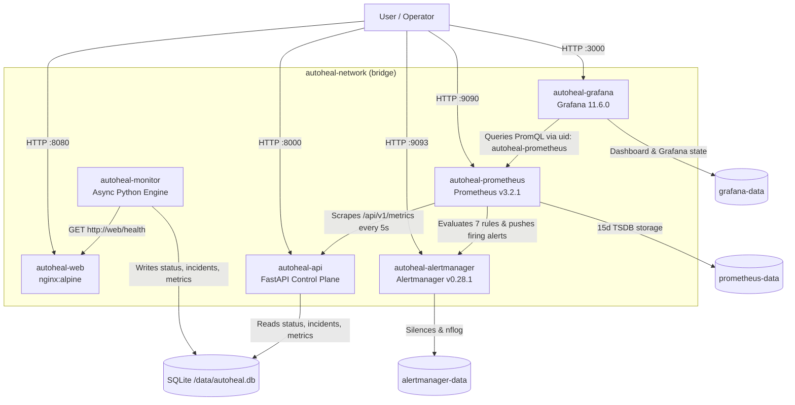

# AutoHeal — Intelligent Self-Healing Infrastructure Automation Platform

> **Current Stage:** Phase 3.5 Completed (Infrastructure Foundation, Python Monitoring Engine, FastAPI Control Plane, Prometheus + Alertmanager + Grafana Observability, Project Cleanup & Consolidated Documentation).
>
> **Scope Boundary:** Automated remediation execution is intentionally deferred to **Phase 4**; existing Ansible recovery files (`ansible/`, `docker/ansible.Dockerfile`, `remediation/recover.yml`) remain preserved and inactive.

---

## Table of Contents

1. [Project Title and Overview](#1-project-title-and-overview)
2. [Project Description](#2-project-description)
3. [Problem Statement](#3-problem-statement)
4. [Project Objectives](#4-project-objectives)
5. [Key Features](#5-key-features)
6. [Technology Stack](#6-technology-stack)
7. [System Architecture](#7-system-architecture)
8. [Project Architecture Diagram](#8-project-architecture-diagram)
9. [Complete Project Directory Structure](#9-complete-project-directory-structure)
10. [Application Workflow](#10-application-workflow)
11. [Monitoring Engine](#11-monitoring-engine)
12. [FastAPI Control Plane](#12-fastapi-control-plane)
13. [Incident Management](#13-incident-management)
14. [Prometheus Monitoring](#14-prometheus-monitoring)
15. [Alertmanager Configuration](#15-alertmanager-configuration)
16. [Grafana Dashboard](#16-grafana-dashboard)
17. [Docker Architecture](#17-docker-architecture)
18. [Installation Prerequisites](#18-installation-prerequisites)
19. [Environment Configuration](#19-environment-configuration)
20. [Installation and Setup](#20-installation-and-setup)
21. [Running the Application](#21-running-the-application)
22. [Accessing Web Application and Services](#22-accessing-web-application-and-services)
23. [API Documentation and Endpoints](#23-api-documentation-and-endpoints)
24. [Prometheus Metrics](#24-prometheus-metrics)
25. [Alerting and Failure Detection](#25-alerting-and-failure-detection)
26. [Testing and Verification](#26-testing-and-verification)
27. [Failure and Recovery Testing](#27-failure-and-recovery-testing)
28. [Security Implementation](#28-security-implementation)
29. [Troubleshooting](#29-troubleshooting)
30. [Current Project Status](#30-current-project-status)
31. [Known Limitations](#31-known-limitations)
32. [Future Roadmap](#32-future-roadmap)
33. [Cleanup and Maintenance Commands](#33-cleanup-and-maintenance-commands)
34. [Git Workflow](#34-git-workflow)
35. [License](#35-license)

---

## 1. Project Title and Overview

**AutoHeal — Intelligent Self-Healing Infrastructure Automation Platform** is an incrementally engineered DevOps platform for containerized service monitoring, persistent incident tracking, Prometheus/Alertmanager/Grafana observability, and upcoming automated Ansible remediation.

Verified natively on **macOS Apple Silicon (M1, `arm64`)** using **Docker Compose v2**, AutoHeal separates the workload under observation (`nginx:alpine`), the asynchronous Python health prober (`httpx`), the read-only FastAPI control plane (`uvicorn`), persistent SQLite telemetry storage (`data/autoheal.db`), and the observability pipeline (Prometheus `v3.2.1`, Alertmanager `v0.28.1`, Grafana `11.6.0`) into distinct hardened containers on a dedicated Docker bridge network (`autoheal-network`).

---

## 2. Project Description

AutoHeal tracks availability and response latency of a containerized HTTP target (`autoheal-web`), applies configurable consecutive failure and recovery thresholds before changing service state, records incident history without duplicate incident noise, exposes operational APIs and Prometheus metrics via FastAPI, evaluates alert rules in Prometheus, routes and inhibits alerts in Alertmanager, and visualizes telemetry through a provisioned Grafana dashboard.

---

## 3. Problem Statement

Standalone container health checks detect isolated probe failures inside Docker, but on their own they do not:

1. Distinguish transient network blips from sustained outages via configurable failure and recovery thresholds.
2. Persist failure reasons, failure counts, timestamps, and incident resolution history across container restarts.
3. Decouple probing logic from queryable control-plane REST APIs, Prometheus time-series telemetry, and structured JSON logging.
4. Provide alert grouping, deduplication, severity inhibition, and dashboard visualization without exposing privileged runtime sockets such as `/var/run/docker.sock`.

AutoHeal addresses these gaps layer by layer while establishing a clean observability foundation before introducing automated recovery in Phase 4.

---

## 4. Project Objectives

- Build an isolated, non-privileged multi-container foundation using Docker Compose and official multi-arch images compatible with Apple Silicon (`arm64`).
- Implement an asynchronous Python monitoring engine (`httpx`) with configurable probe intervals, timeouts, failure thresholds, recovery thresholds, and graceful `SIGINT`/`SIGTERM` shutdown.
- Track single open incidents per outage (`open` -> `resolved`) in WAL-mode SQLite (`data/autoheal.db`) shared cleanly with a read-only FastAPI control plane.
- Export Prometheus-compatible counters, gauges, and latency histograms at `/api/v1/metrics`.
- Scrape metrics into Prometheus (`5s` interval), evaluate service/monitor/API/incident alert rules, group and inhibit alerts via Alertmanager, and provision an auto-loaded Grafana dashboard.
- Enforce container hardening (`read_only: true`, `cap_drop: ALL`, `no-new-privileges:true`, `:ro` config mounts, secret exclusion via `.gitignore`).
- Maintain automated tests (`pytest`) and native configuration checks (`promtool`, `amtool`, `docker compose config`) before adding automated Ansible remediation in Phase 4.

---

## 5. Key Features

- **Responsive Nginx Target App (`autoheal-web`):** Lightweight static HTML/CSS/JS status UI at `/` fetching `/health` (`{"status": "healthy", "service": "web"}`), hardened Nginx headers (`server_tokens off`, `X-Content-Type-Options`, `X-Frame-Options`, `Referrer-Policy`), and Docker `HEALTHCHECK`.
- **Asynchronous Monitoring Loop (`autoheal-monitor`):** Non-blocking `asyncio` + `httpx.AsyncClient` health checks detecting HTTP errors, invalid JSON payloads, connection errors, and timeouts.
- **Threshold-Driven State Machine:** Avoids alert flapping using `MONITOR_FAILURE_THRESHOLD` (default `3`) and `MONITOR_RECOVERY_THRESHOLD` (default `2`) backed by SQLite transactions.
- **Deduplicated Incident Lifecycle:** Opens one incident when a service transitions to `UNHEALTHY`, increments `failure_count` and updates `last_seen_at` / `failure_reason` on repeated failures, and resolves the incident automatically on recovery—even across container restarts.
- **Decoupled FastAPI Control Plane (`autoheal-api`):** Exposes `/health`, `/api/v1/status`, `/api/v1/incidents`, `/api/v1/incidents/{incident_id}`, and `/api/v1/metrics` plus middleware request tracking (`autoheal_api_requests_total`) and structured JSON logs.
- **Prometheus Time-Series & Rules Engine (`autoheal-prometheus`):** Scrapes `/api/v1/metrics` every `5s`, retains TSDB data for `15d` in `prometheus-data`, and evaluates 7 alert rules.
- **Alertmanager Routing & Inhibition (`autoheal-alertmanager`):** Groups alerts by `alertname`, `service`, and `severity`; suppresses redundant `warning` alerts when `AutoHealServiceDown` or `AutoHealApiDown` (`critical`) is active; supports external receivers via `.env` (`ALERTMANAGER_CONFIG_FILE`).
- **Auto-Provisioned Grafana Dashboard (`autoheal-grafana`):** Pre-configured Prometheus datasource (`autoheal-prometheus`) and 10-panel **AutoHeal Infrastructure Overview** (`autoheal-overview`) dashboard.
- **Hardened Security Posture:** Dedicated bridge network (`autoheal-network`), read-only root filesystems with scoped `tmpfs`, dropped Linux capabilities, non-root users, and zero Docker socket mounts in active services.

---

## 6. Technology Stack

| Component | Version / Image | Phase | Purpose |
|---|---|---|---|
| Docker & Docker Compose | Compose v2 | Phase 1–3 | Hardened multi-container orchestration on `autoheal-network` |
| Nginx | `nginx:alpine` | Phase 1 | Target web server serving `/` and JSON `/health` |
| Python | `3.12-slim` (Docker) / `3.10+` | Phase 2 | Async monitoring engine and FastAPI backend runtime |
| `httpx` | `>=0.27.0,<1.0.0` | Phase 2 | Asynchronous HTTP health probe client |
| `pydantic` & `pydantic-settings` | `>=2.7.0`, `>=2.2.0` | Phase 2 | Environment configuration validation & API response models |
| FastAPI & Uvicorn | `>=0.115.0`, `>=0.34.0` | Phase 2 | Decoupled REST control plane and ASGI server |
| SQLite (WAL mode) | Python stdlib `sqlite3` | Phase 2 | Shared persistent status, incident history, and metrics store |
| `prometheus-client` | `>=0.20.0,<1.0.0` | Phase 2 | In-process monitoring registry & custom `AutoHealDbCollector` |
| Prometheus | `prom/prometheus:v3.2.1` | Phase 3 | Scrape `/api/v1/metrics`, 15-day TSDB, evaluate 7 alert rules |
| Alertmanager | `prom/alertmanager:v0.28.1` | Phase 3 | Alert grouping, deduplication, routing, inhibition |
| Grafana | `grafana/grafana:11.6.0` | Phase 3 | Provisioned datasource & **AutoHeal Infrastructure Overview** |
| `pytest`, `pytest-asyncio`, `pyyaml` | `>=8.3.0`, `>=0.25.0`, `>=6.0.0` | Phase 2–3 | Automated unit, API, and observability config validation |
| Ansible (`ansible/`, `remediation/`) | `ansible-core` (`python:3.12-alpine`) | Planned (Phase 4) | Preserved recovery playbooks and container definition (inactive) |
| AWS & Terraform | — | Planned (Phase 5) | Future cloud infrastructure provisioning and CI/CD |

---

## 7. System Architecture

AutoHeal uses clean separation of concerns across six running containers:

1. **Workload Layer (`autoheal-web`):** Serves the demonstration HTML application at `/` and returns HTTP `200` `{"status": "healthy", "service": "web"}` at `/health`. Runs independently on `autoheal-network` with port `${APP_PORT:-8080}:80`.
2. **Monitoring Layer (`autoheal-monitor`):** Polls `MONITOR_TARGET_URL` (`http://web/health`) every `MONITOR_INTERVAL` seconds. Evaluates probes through `IncidentManager`, updates `MonitorMetrics`, touches `/tmp/monitor.heartbeat`, and writes state into `./data/autoheal.db` (mounted to `/data`). Exposes **no host ports**.
3. **Control Plane Layer (`autoheal-api`):** Reads `service_status`, `incidents`, and persisted metric tables from `/data/autoheal.db`, adds HTTP request counters (`autoheal_api_requests_total`), and serves JSON endpoints plus Prometheus exposition text on port `${API_PORT:-8000}:8000`.
4. **Metrics & Rule Evaluation Layer (`autoheal-prometheus`):** Scrapes `http://api:8000/api/v1/metrics` and `localhost:9090` every `5s` (`global.external_labels` set `environment: local`, `project: autoheal` without overriding the metric label `service="web"`), evaluates `/etc/prometheus/rules/autoheal_alerts.yml`, persists 15 days of TSDB metrics in `prometheus-data`, and pushes alerts to `alertmanager:9093`.
5. **Alert Routing Layer (`autoheal-alertmanager`):** Deduplicates, groups (`alertname`, `service`, `severity`), routes by severity, and enforces inhibition rules (`AutoHealServiceDown` -> suppresses service/monitor warnings; `AutoHealApiDown` -> suppresses `AutoHealApiServerErrors`). Persists silences and notification logs in `alertmanager-data`.
6. **Visualization Layer (`autoheal-grafana`):** Auto-provisions `Prometheus` (`uid: autoheal-prometheus`, `http://prometheus:9090`) and loads the **AutoHeal Infrastructure Overview** dashboard (`uid: autoheal-overview`) with 10 panels, persisting user/UI state in `grafana-data`.

---

## 8. Project Architecture Diagram



---

## 9. Complete Project Directory Structure

```text
AutoHeal/
├── .env.example                                  # Committed environment variable template
├── .gitignore                                    # Ignores .env, .venv/, data/*.db*, *.local.yml, logs/*
├── README.md                                     # Consolidated project documentation (single source of truth)
├── compose.yaml                                  # Hardened 6-service Docker Compose stack
├── app/                                          # Phase 1 target web application
│   ├── html/
│   │   └── index.html                            # Lightweight status page querying /health
│   └── nginx/
│       └── default.conf                          # Security headers, /, and JSON /health route
├── monitoring/                                   # Phase 2 asynchronous Python monitoring engine
│   ├── Dockerfile                                # Non-root python:3.12-slim image + heartbeat HEALTHCHECK
│   ├── requirements.txt                          # httpx, pydantic, pydantic-settings, prometheus-client
│   └── src/
│       ├── __init__.py
│       ├── config.py                             # MonitorSettings Pydantic validation & legacy aliases
│       ├── health_checker.py                     # AsyncHealthChecker HTTP/JSON probe & error classification
│       ├── incident_manager.py                   # SQLite WAL state machine & incident lifecycle manager
│       ├── logging_config.py                     # Single-line JSON log formatter
│       ├── main.py                               # Async entrypoint & SIGINT/SIGTERM signal handling
│       ├── metrics.py                            # MonitorMetrics Prometheus registry + SQLite persistence
│       ├── models.py                             # Enums & immutable dataclasses (ServiceState, IncidentRecord, etc.)
│       └── monitor.py                            # MonitoringEngine orchestration loop & heartbeat touch
├── api/                                          # Phase 2 decoupled FastAPI control plane
│   ├── Dockerfile                                # Non-root python:3.12-slim image + HTTP /health check
│   ├── requirements.txt                          # fastapi, uvicorn, pydantic, pydantic-settings, prometheus-client
│   └── src/
│       ├── __init__.py
│       ├── config.py                             # ApiSettings validation & cache management
│       ├── database.py                           # SQLite schema initialization, WAL access, health check
│       ├── logging_config.py                     # Structured JSON logger for API requests & lifecycle
│       ├── main.py                               # FastAPI app factory, lifespan hook, request counter middleware
│       ├── routes/
│       │   ├── __init__.py
│       │   ├── health.py                         # GET /health
│       │   ├── incidents.py                      # GET /api/v1/incidents & GET /api/v1/incidents/{id}
│       │   ├── metrics.py                        # GET /api/v1/metrics via AutoHealDbCollector
│       │   └── status.py                         # GET /api/v1/status
│       └── schemas/
│           ├── __init__.py
│           ├── health.py                         # ApiHealthResponse
│           ├── incident.py                       # IncidentResponse, IncidentListResponse
│           └── status.py                         # ServiceStatusResponse
├── observability/                                # Phase 3 monitoring, alerting & dashboard stack
│   ├── alertmanager/
│   │   └── alertmanager.yml                      # Grouping, severity routing, inhibit rules, receivers
│   ├── grafana/
│   │   └── provisioning/
│   │       ├── dashboards/
│   │       │   ├── dashboards.yml                # File dashboard provider configuration
│   │       │   └── autoheal_overview.json        # 10-panel AutoHeal Infrastructure Overview dashboard
│   │       └── datasources/
│   │           └── prometheus.yml                # Provisioned default Prometheus datasource
│   └── prometheus/
│       ├── prometheus.yml                        # Global 5s scrape & alertmanager target config
│       └── rules/
│           └── autoheal_alerts.yml               # 7 alert rules (service, monitor, API, incident)
├── tests/                                        # Automated unit, API & observability config test suite
│   ├── requirements.txt                          # Inherits monitoring + api deps plus pytest, pytest-asyncio, pyyaml
│   ├── test_api.py                               # FastAPI endpoints & SQLite integration tests
│   ├── test_config.py                            # MonitorSettings & ApiSettings validation tests
│   ├── test_engine.py                            # MonitoringEngine loop, shutdown & JSON logging tests
│   ├── test_health_checker.py                    # AsyncHealthChecker HTTP, payload, timeout & connection tests
│   ├── test_incident_manager.py                  # Threshold state transitions, deduplication & restart recovery
│   └── test_observability_config.py              # Prometheus, Alertmanager, Grafana & Compose hardening tests
├── data/
│   └── .gitkeep                                  # Preserves data/ mount directory (autoheal.db* gitignored)
├── ansible/                                      # Preserved Phase 4 automation artifacts (inactive)
│   ├── ansible.cfg
│   ├── inventory.ini
│   ├── site.yml
│   └── webserver.yml
├── docker/
│   └── ansible.Dockerfile                        # Preserved Phase 4 Ansible container definition (inactive)
├── remediation/
│   └── recover.yml                               # Preserved Phase 4 Ansible recovery playbook (inactive)
└── logs/                                         # Runtime log directory (`logs/*` gitignored; remediation.log local only)
```

---

## 10. Application Workflow

1. **Boot & Dependency Ordering:** Docker Compose starts `autoheal-web`, waits for its `/health` check to pass, starts `autoheal-monitor` (initializing SQLite WAL tables and `service_status` as `unknown` if absent), starts `autoheal-api` and `autoheal-alertmanager`, then starts `autoheal-prometheus`, and finally `autoheal-grafana`.
2. **Steady-State Probing:** Every `5s` (`MONITOR_INTERVAL`), `autoheal-monitor` sends `GET http://web/health` (`timeout=3s`) and validates both HTTP `200` and JSON `{"status": "healthy", "service": "web"}`.
3. **Persistence & Telemetry Update:** Each check updates `service_status`, counters (`autoheal_health_checks_total`), latency histogram (`autoheal_health_check_duration_seconds`), and gauges in `/data/autoheal.db`, while refreshing `/tmp/monitor.heartbeat`.
4. **Threshold Breach & Incident Open:** If consecutive failed checks reach `MONITOR_FAILURE_THRESHOLD` (`3`), the state becomes `UNHEALTHY` and one `open` incident is inserted. Further failures increment `failure_count` and update `failure_reason` and `last_seen_at` on the same incident.
5. **Control Plane & Scraping:** `autoheal-prometheus` scrapes `http://api:8000/api/v1/metrics` every `5s`. `AutoHealDbCollector` reads SQLite directly on scrape, keeping metrics accurate without cross-container IPC.
6. **Alert Evaluation & Inhibition:** Prometheus fires `AutoHealConsecutiveCheckFailures` / `AutoHealMonitoringProbeFailures` (warning) and `AutoHealServiceDown` / `AutoHealUnresolvedIncident` (critical). Alertmanager groups by `alertname`, `service`, `severity` and inhibits warning noise once `AutoHealServiceDown` fires.
7. **Recovery & Resolution:** Once the target returns healthy checks for `MONITOR_RECOVERY_THRESHOLD` (`2`) consecutive cycles, `autoheal-monitor` transitions `UNHEALTHY -> HEALTHY`, resolves the open incident (`resolved_at`), Prometheus marks alerts resolved, and Alertmanager clears active alerts.

---

## 11. Monitoring Engine

Implemented in `monitoring/src/`:

- **`AsyncHealthChecker` (`health_checker.py`):** Uses `httpx.AsyncClient` and categorizes every probe into `CheckOutcome`:
  - `success`: HTTP `200` and JSON dict matching `status == "healthy"` and `service == self.service_name`
  - `http_error`: Non-`200` HTTP response
  - `invalid_response`: Invalid JSON, non-object payload, or mismatched `status`/`service` fields
  - `connection_error`: `httpx.RequestError` (e.g., DNS failure, connection refused)
  - `timeout`: `httpx.TimeoutException`
- **`MonitorSettings` (`config.py`):** Loaded via `pydantic-settings` from `.env` / environment variables. Validates HTTP/HTTPS `MONITOR_TARGET_URL`, non-empty `MONITOR_TARGET_SERVICE`, positive floats for `MONITOR_INTERVAL` and `MONITOR_TIMEOUT` (also accepting legacy aliases `MONITOR_INTERVAL_SECONDS` / `MONITOR_TIMEOUT_SECONDS`), positive integers (`>= 1`) for thresholds, and standard `LOG_LEVEL`.
- **`MonitoringEngine` (`monitor.py` & `main.py`):** Handles `MONITOR_ENABLED=false` (idles while keeping container heartbeat alive), catches unexpected exceptions inside `run_once()` without crashing the loop, writes structured single-line JSON logs via `logging_config.py`, and handles `SIGINT` / `SIGTERM` via `asyncio.Event` to close HTTP resources cleanly.
- **Heartbeat Check:** Container healthcheck verifies `/tmp/monitor.heartbeat` mtime is newer than `MONITOR_INTERVAL * 3 + 10` seconds.

---

## 12. FastAPI Control Plane

Implemented in `api/src/`:

- **Stateless Read-Only DB Consumer (`database.py`):** Opens SQLite with `timeout=5.0` and `PRAGMA busy_timeout=5000`, ensuring safe concurrent reads alongside the monitoring engine's WAL writer. Ensures schema creation on startup (`lifespan`) so API startup remains resilient even before the first probe finishes.
- **Request Observability (`main.py`):** Middleware intercepts every HTTP request, resolves route templates (avoiding high-cardinality metric labels), increments `autoheal_api_requests_total{method, path, status_code}`, and emits structured JSON access logs including `duration_ms`.
- **Clean Separation:** `api/` runs in its own Uvicorn container (`autoheal-api`) with its own `Dockerfile`, requirements, settings (`ApiSettings`), and schema models, exposing read-only REST + Prometheus endpoints without owning probe scheduling.

---

## 13. Incident Management

Implemented in `monitoring/src/incident_manager.py` inside atomic `with conn:` SQLite transactions:

| Table | Purpose |
|---|---|
| `service_status` | Latest state per service (`unknown`, `healthy`, `unhealthy`), consecutive counters, last HTTP status, response latency (`ms`), error, timestamps, and `active_incident_id` |
| `incidents` | Historical log (`id`, `service_name`, `status` [`open`/`resolved`], `failure_reason`, `started_at`, `resolved_at`, `last_seen_at`, `failure_count`) indexed by `(service_name, status)` |
| `monitoring_counters` | Persistent cumulative Prometheus counters (`autoheal_health_checks_total`, `autoheal_incidents_total`) |
| `monitoring_histogram_buckets` | Persistent cumulative probe latency bucket counts across restarts |
| `monitoring_histogram_totals` | Persistent histogram `total_sum` and `total_count` |

**State Machine Guarantees:**
- `UNKNOWN -> HEALTHY`: First successful probe marks service healthy.
- `HEALTHY / UNKNOWN -> UNHEALTHY`: Requires `consecutive_failures >= failure_threshold`; creates one `open` incident with `initial_failures = consecutive_failures`.
- **Deduplication While Open:** Subsequent failures while an incident is `open` update `last_seen_at`, `failure_reason`, and increment `failure_count` on the existing incident rather than inserting duplicate rows.
- `UNHEALTHY -> HEALTHY`: Requires `consecutive_successes >= recovery_threshold`; marks the open incident `resolved`, sets `resolved_at`, and clears `active_incident_id`.
- **Restart Persistence:** Both `IncidentManager` and `MonitorMetrics` read from `./data/autoheal.db`, preserving open incident state, failure/success counters, and cumulative Prometheus counters/histograms across restarts.

---

## 14. Prometheus Monitoring

Configured in `observability/prometheus/prometheus.yml`:

- **Scrape & Evaluation Cadence:** `scrape_interval: 5s`, `evaluation_interval: 5s`.
- **External Labels:** `environment: local`, `project: autoheal`.
- **Jobs:**
  - `prometheus` -> `localhost:9090`
  - `autoheal-api` -> `api:8000` at `metrics_path: /api/v1/metrics` (deliberately omits a target `service` label so the application's `service="web"` metric label is preserved rather than renamed to `exported_service`)
- **Rule Files:** Loads `/etc/prometheus/rules/*.yml` (`observability/prometheus/rules/autoheal_alerts.yml`).
- **Alertmanager Integration:** Sends evaluated alerts to `alertmanager:9093`.
- **Storage Retention:** `--storage.tsdb.path=/prometheus`, `--storage.tsdb.retention.time=15d` backed by named volume `prometheus-data`.

---

## 15. Alertmanager Configuration

Configured in `observability/alertmanager/alertmanager.yml`:

- **Global Resolve Timeout:** `1m`.
- **Grouping & Deduplication:** `group_by: [alertname, service, severity]`, root `group_wait: 10s`, `group_interval: 30s`, `repeat_interval: 1h`.
- **Severity Sub-Routes:**
  - `severity = "critical"` -> receiver `autoheal-critical` (`group_wait: 5s`, `repeat_interval: 30m`)
  - `severity = "warning"` -> receiver `autoheal-warning` (`group_wait: 15s`, `repeat_interval: 1h`)
  - Fallback -> receiver `autoheal-default`
- **Inhibition Rules:**
  1. When `AutoHealServiceDown` (`severity="critical"`) is firing, suppress `severity="warning"` alerts where `component =~ "target-service|monitoring"` for the same `service`.
  2. When `AutoHealApiDown` (`severity="critical"`) is firing, suppress `AutoHealApiServerErrors` (`severity="warning"`).
- **Private Notification Override:** Point `ALERTMANAGER_CONFIG_FILE` in `.env` to a gitignored `observability/alertmanager/*.local.yml` file to enable Slack, webhook, or email receivers without committing secrets.

---

## 16. Grafana Dashboard

Auto-provisioned via `observability/grafana/provisioning/`:

- **Datasource (`datasources/prometheus.yml`):** `Prometheus` (`uid: autoheal-prometheus`, default datasource, `access: proxy`, `url: http://prometheus:9090`, `editable: false`, `timeInterval: 5s`).
- **Dashboard Provider (`dashboards/dashboards.yml`):** Watches `/etc/grafana/provisioning/dashboards` in folder `AutoHeal` (`updateIntervalSeconds: 30`).
- **Dashboard (`dashboards/autoheal_overview.json`):** **AutoHeal Infrastructure Overview** (`uid: autoheal-overview`, 10 panels):
  1. `Web Service Availability` (`stat`) — `autoheal_service_up{service="web"}`
  2. `Open Incidents` (`stat`) — `autoheal_open_incidents{service="web"}`
  3. `Consecutive Failures` (`stat`) — `autoheal_consecutive_failures{service="web"}`
  4. `Control Plane Scrape Status` (`stat`) — `up{job="autoheal-api"}`
  5. `Service Status & Open Incidents Timeline` (`timeseries`) — `autoheal_service_up{service="web"}`, `autoheal_open_incidents{service="web"}`
  6. `Health Check Rate by Outcome (checks/min)` (`timeseries`) — `sum by (outcome) (rate(autoheal_health_checks_total{service="web"}[1m])) * 60`
  7. `Health Check Latency (p50 & p95)` (`timeseries`) — `histogram_quantile(0.50, ...)` & `histogram_quantile(0.95, ...)` on `autoheal_health_check_duration_seconds_bucket`
  8. `Control Plane API Request Rate (req/min)` (`timeseries`) — `sum by (path, status_code) (rate(autoheal_api_requests_total[1m])) * 60`
  9. `Cumulative Incident Events` (`stat`) — `autoheal_incidents_total{service="web"}`
  10. `Firing Prometheus Alerts` (`stat`) — `count(ALERTS{alertstate="firing"}) or vector(0)`

---

## 17. Docker Architecture

Defined in `compose.yaml`:

- **Dedicated Bridge Network:** `autoheal-network` (`driver: bridge`).
- **Services & Dependencies:**
  - `web` (`autoheal-web`, `nginx:alpine`) — base service, `HEALTHCHECK` on `http://127.0.0.1/health`
  - `monitor` (`autoheal-monitor`, built from `monitoring/Dockerfile`) — `depends_on: web (service_healthy)`
  - `api` (`autoheal-api`, built from `api/Dockerfile`) — `depends_on: web (service_healthy)` and `monitor (service_healthy)`
  - `alertmanager` (`autoheal-alertmanager`, `prom/alertmanager:v0.28.1`) — `HEALTHCHECK` on `/-/healthy`
  - `prometheus` (`autoheal-prometheus`, `prom/prometheus:v3.2.1`) — `depends_on: api (service_healthy)` and `alertmanager (service_healthy)`
  - `grafana` (`autoheal-grafana`, `grafana/grafana:11.6.0`) — `depends_on: prometheus (service_healthy)`
- **Restart Policy:** All services use `restart: unless-stopped`.
- **Persistence:** Bind mount `./data:/data` for SQLite plus Docker named volumes `prometheus-data`, `alertmanager-data`, and `grafana-data`.

---

## 18. Installation Prerequisites

- **Docker Desktop** with Docker Engine & Docker Compose v2 (verified on macOS Apple Silicon M1 `arm64`, Docker `29.1.3`, Compose `v2.40.3-desktop.1`)
- **Git** and **curl**
- **Python 3.10+** (only needed on the host to run the automated `pytest` test suite inside a local `.venv`; containers package Python 3.12 internally)

---

## 19. Environment Configuration

Create your local `.env` from the committed template:

```bash
cp .env.example .env
```

| Variable | Default | Service(s) | Purpose |
|---|---|---|---|
| `APP_ENV` | `development` | General | Environment label |
| `APP_PORT` | `8080` | `web` | Host port mapped to container `:80` |
| `API_PORT` | `8000` | `api` | Host & API server port |
| `MONITOR_ENABLED` | `true` | `monitor`, `api` | Enables/pauses active probing in monitor loop |
| `MONITOR_TARGET_URL` | `http://web/health` | `monitor`, `api` | Health endpoint probed by monitor |
| `MONITOR_TARGET_SERVICE` | `web` | `monitor`, `api` | Expected `service` value and metric label |
| `MONITOR_INTERVAL` | `5` | `monitor` | Seconds between probes (also accepts `MONITOR_INTERVAL_SECONDS`) |
| `MONITOR_TIMEOUT` | `3` | `monitor` | HTTP request timeout in seconds (also accepts `MONITOR_TIMEOUT_SECONDS`) |
| `MONITOR_FAILURE_THRESHOLD` | `3` | `monitor` | Consecutive failures to mark `unhealthy` & open incident |
| `MONITOR_RECOVERY_THRESHOLD` | `2` | `monitor` | Consecutive successes to mark `healthy` & resolve incident |
| `AUTOHEAL_DB_PATH` | `/data/autoheal.db` | `monitor`, `api` | SQLite database file path inside containers |
| `LOG_LEVEL` | `INFO` | `monitor`, `api` | Python logging threshold (`DEBUG`..`CRITICAL`) |
| `PROMETHEUS_PORT` | `9090` | `prometheus` | Host port mapped to Prometheus UI/API `:9090` |
| `ALERTMANAGER_PORT` | `9093` | `alertmanager` | Host port mapped to Alertmanager UI/API `:9093` |
| `ALERTMANAGER_CONFIG_FILE` | `./observability/alertmanager/alertmanager.yml` | `alertmanager` | Config path mounted `:ro` (swap for untracked `*.local.yml`) |
| `GRAFANA_PORT` | `3000` | `grafana` | Host port mapped to Grafana UI `:3000` |
| `GRAFANA_ADMIN_USER` | `admin` | `grafana` | Grafana administrator username |
| `GRAFANA_ADMIN_PASSWORD` | `admin` | `grafana` | Grafana administrator password (change in `.env` outside local dev) |

---

## 20. Installation and Setup

1. Clone the repository and enter the project directory:
   ```bash
   git clone https://github.com/deewakar05/AutoHeal.git
   cd AutoHeal
   ```
2. Create `.env` from `.env.example`:
   ```bash
   cp .env.example .env
   ```
3. *(Optional for local pytest suite)* Create a Python virtual environment and install test dependencies:
   ```bash
   python3 -m venv .venv
   .venv/bin/pip install -r tests/requirements.txt
   ```
4. Validate Compose configuration before starting:
   ```bash
   docker compose config -q
   ```

---

## 21. Running the Application

Start and build all 6 services in detached mode:

```bash
docker compose up --build -d
```

Check container readiness and health status:

```bash
docker compose ps
```

Inspect structured logs from specific services:

```bash
docker compose logs -f monitor api
```

Stop containers without erasing SQLite or observability volumes:

```bash
docker compose down
```

---

## 22. Accessing Web Application and Services

| Service | Container Name | Host URL | Key Paths / Credentials |
|---|---|---|---|
| Web Application | `autoheal-web` | `http://localhost:8080/` | `/` (landing page), `/health` (JSON health) |
| FastAPI Control Plane | `autoheal-api` | `http://localhost:8000/` | `/health`, `/docs`, `/api/v1/status`, `/api/v1/incidents`, `/api/v1/metrics` |
| Prometheus | `autoheal-prometheus` | `http://localhost:9090/` | `/targets`, `/rules`, `/alerts`, `/graph` |
| Alertmanager | `autoheal-alertmanager` | `http://localhost:9093/` | `/#/alerts`, `/api/v2/status` |
| Grafana | `autoheal-grafana` | `http://localhost:3000/` | Login via `.env` (`admin` / `admin` local default); **AutoHeal -> AutoHeal Infrastructure Overview** |

---

## 23. API Documentation and Endpoints

FastAPI serves interactive OpenAPI documentation at `http://localhost:8000/docs`.

### `GET /health`
Control plane and SQLite readiness check.

```bash
curl -s http://localhost:8000/health
```
```json
{
  "status": "healthy",
  "service": "api",
  "database": "connected"
}
```
Returns HTTP `503` if SQLite connectivity fails.

### `GET /api/v1/status`
Returns current persisted state for `MONITOR_TARGET_SERVICE` (or optional query `?service=<name>`). Returns `"status": "unknown"` if no checks have been recorded yet.

```bash
curl -s http://localhost:8000/api/v1/status
```
```json
{
  "service_name": "web",
  "target_url": "http://web/health",
  "status": "healthy",
  "monitor_enabled": true,
  "consecutive_failures": 0,
  "consecutive_successes": 42,
  "last_checked_at": "2026-11-11T08:00:00+00:00",
  "last_status_change_at": "2026-11-11T07:55:00+00:00",
  "last_http_status": 200,
  "last_response_time_ms": 1.85,
  "last_error": null,
  "active_incident_id": null
}
```

### `GET /api/v1/incidents` & `GET /api/v1/incidents/{incident_id}`
Lists recorded incidents newest-first (`?status=open|resolved`, `?service=<name>`, `?limit=1..500`), or fetches one incident by integer ID (`404` if not found).

```bash
curl -s "http://localhost:8000/api/v1/incidents?limit=5"
```
```json
{
  "total": 1,
  "open_count": 0,
  "incidents": [
    {
      "id": 1,
      "service_name": "web",
      "status": "resolved",
      "failure_reason": "Connection error probing http://web/health: ...",
      "started_at": "2026-11-11T07:50:10+00:00",
      "resolved_at": "2026-11-11T07:51:05+00:00",
      "last_seen_at": "2026-11-11T07:50:55+00:00",
      "failure_count": 10
    }
  ]
}
```

### `GET /api/v1/metrics`
Exposes Prometheus `text/plain; version=0.0.4; charset=utf-8` metrics combining SQLite-persisted monitoring telemetry and live API request counts.

---

## 24. Prometheus Metrics

| Metric Name | Type | Labels | Description |
|---|---|---|---|
| `autoheal_service_up` | Gauge | `service` | `1` when `status == "healthy"`, else `0` |
| `autoheal_consecutive_failures` | Gauge | `service` | Current consecutive failed probe count |
| `autoheal_consecutive_successes` | Gauge | `service` | Current consecutive successful probe count |
| `autoheal_open_incidents` | Gauge | `service` | Current count of `open` incidents for the service |
| `autoheal_health_checks_total` | Counter | `service`, `outcome` | Cumulative health probes (`success`, `http_error`, `connection_error`, `timeout`, `invalid_response`) |
| `autoheal_health_check_duration_seconds` | Histogram | `service` | Probe HTTP latency histogram (`0.005s` to `10.0s` buckets + `+Inf`) |
| `autoheal_incidents_total` | Counter | `service`, `event` | Cumulative incident events (`created`, `resolved`) |
| `autoheal_api_requests_total` | Counter | `method`, `path`, `status_code` | Total HTTP requests served by `autoheal-api` |

---

## 25. Alerting and Failure Detection

Defined in `observability/prometheus/rules/autoheal_alerts.yml` (group `autoheal_service_and_platform_alerts`, evaluated every `5s`):

| Alert Name | PromQL Expression | `for` | Severity | Component | Verification Level |
|---|---|---|---|---|---|
| `AutoHealServiceDown` | `autoheal_service_up == 0` | `10s` | `critical` | `target-service` | Live outage + resolution verified |
| `AutoHealConsecutiveCheckFailures` | `autoheal_consecutive_failures > 0` | `5s` | `warning` | `target-service` | Live outage (inhibited) + resolution verified |
| `AutoHealMonitoringProbeFailures` | `sum by (service) (increase(autoheal_health_checks_total{outcome!="success"}[1m])) > 0` | `10s` | `warning` | `monitoring` | Live outage (inhibited) + resolution verified |
| `AutoHealUnresolvedIncident` | `autoheal_open_incidents > 0` | `20s` | `critical` | `incident-management` | Live outage + resolution verified |
| `AutoHealMonitoringEngineStalled` | `sum by (service) (increase(autoheal_health_checks_total[30s])) == 0` | `25s` | `critical` | `monitoring` | Static (`promtool`, `pytest`, `/api/v1/rules`) |
| `AutoHealApiDown` | `up{job="autoheal-api"} == 0` | `10s` | `critical` | `control-plane-api` | Static (`promtool`, `pytest`, `/api/v1/rules`) |
| `AutoHealApiServerErrors` | `sum(rate(autoheal_api_requests_total{status_code=~"5.."}[1m])) > 0` | `10s` | `warning` | `control-plane-api` | Static (`promtool`, `pytest`, `/api/v1/rules`) |

---

## 26. Testing and Verification

Run the automated test suite and native config validators:

```bash
# Automated unit, API, and observability configuration tests (30 tests across 6 files)
.venv/bin/python -B -m pytest -p no:cacheprovider -v tests/

# Validate Compose syntax
docker compose config -q

# Validate Prometheus config and alert rules inside running container
docker exec autoheal-prometheus promtool check config /etc/prometheus/prometheus.yml

# Validate Alertmanager routing and inhibition config inside running container
docker exec autoheal-alertmanager amtool check-config /etc/alertmanager/alertmanager.yml

# Optional syntax validation of preserved Phase 4 Ansible playbooks (uses existing image, no socket mount)
docker run --rm -v "$PWD":/workspace -w /workspace/ansible autoheal-ansible:latest \
  ansible-playbook --syntax-check site.yml webserver.yml ../remediation/recover.yml
```

Check live service endpoints:

```bash
curl -s http://localhost:8080/health
curl -s http://localhost:8000/health
curl -s http://localhost:8000/api/v1/status
curl -s "http://localhost:9090/api/v1/targets"
curl -s "http://localhost:9093/api/v2/status"
curl -s "http://localhost:3000/api/health"
```

---

## 27. Failure and Recovery Testing

To verify failure detection, incident deduplication, Alertmanager inhibition, and automatic resolution end-to-end:

1. **Inject a controlled outage** by stopping only `autoheal-web`:
   ```bash
   docker compose stop web
   ```
2. **Observe failure progression** (with defaults `MONITOR_INTERVAL=5`, `MONITOR_FAILURE_THRESHOLD=3`, outage detected in ~15s):
   ```bash
   curl -s http://localhost:8000/api/v1/status
   curl -s "http://localhost:8000/api/v1/incidents?status=open"
   ```
   Wait ~30–40s for Prometheus `for` windows (`5s`–`20s`), then query active alerts:
   ```bash
   curl -s http://localhost:9090/api/v1/alerts
   curl -s http://localhost:9093/api/v2/alerts
   ```
   Expected Alertmanager state: `AutoHealServiceDown` (`critical`) and `AutoHealUnresolvedIncident` (`critical`) are `active`, while `AutoHealConsecutiveCheckFailures` (`warning`) and `AutoHealMonitoringProbeFailures` (`warning`) are `suppressed` via inhibition.
3. **Restore the service** (`MONITOR_RECOVERY_THRESHOLD=2`):
   ```bash
   docker compose start web
   ```
   After 2 consecutive healthy checks (~10s) and alert resolve intervals, confirm recovery:
   ```bash
   curl -s http://localhost:8000/api/v1/status
   curl -s http://localhost:8000/api/v1/incidents
   curl -s http://localhost:9090/api/v1/alerts
   ```

---

## 28. Security Implementation

| Container | Execution User | Root Filesystem | Dropped Caps | Privilege Escalation | Docker Socket |
|---|---|---|---|---|---|
| `autoheal-web` | `nginx` worker user | Config & HTML mounted `:ro` | `ALL` (+ minimal nginx bind/setuid caps) | `no-new-privileges:true` | None |
| `autoheal-monitor` | `autoheal` (`10001`) | `read_only: true` (`tmpfs /tmp`) | `ALL` | `no-new-privileges:true` | None |
| `autoheal-api` | `autoheal` (`10001`) | `read_only: true` (`tmpfs /tmp`) | `ALL` | `no-new-privileges:true` | None |
| `autoheal-prometheus` | `nobody` (`65534`) | `read_only: true` | `ALL` | `no-new-privileges:true` | None |
| `autoheal-alertmanager` | `nobody` (`65534`) | `read_only: true` | `ALL` | `no-new-privileges:true` | None |
| `autoheal-grafana` | `grafana` (`472`) | `read_only: true` (`tmpfs /tmp`, `/var/log/grafana`) | `ALL` | `no-new-privileges:true` | None |

Additional safeguards:
- `.env`, `observability/alertmanager/*.local.yml`, `data/*.db*`, `logs/*`, `.venv/`, `__pycache__/`, and `.pytest_cache/` are excluded via `.gitignore`.
- Grafana disables user signup (`GF_USERS_ALLOW_SIGN_UP=false`) and telemetry reporting (`GF_ANALYTICS_REPORTING_ENABLED=false`).
- Only `api`, `web`, `prometheus`, `alertmanager`, and `grafana` expose host ports; `autoheal-monitor` has zero host port bindings.
- `.env.example` ships `GRAFANA_ADMIN_PASSWORD=admin` strictly for local evaluation—override in `.env` for shared environments.

---

## 29. Troubleshooting

- **Ports already allocated (`8080`, `8000`, `9090`, `9093`, `3000`):** Override conflicting port variables in `.env` (e.g., `APP_PORT=8081`) and re-run `docker compose up -d`.
- **SQLite `database is locked` or missing tables on fresh start:** Confirm `./data` exists and is writable by UID `10001` (inside containers); both `monitor` and `api` set `PRAGMA busy_timeout=5000` and initialize schema on startup.
- **`autoheal-monitor` fails health check:** Check `docker compose logs monitor`. Verify `MONITOR_INTERVAL` matches expected probe cadence (`HEARTBEAT_PATH=/tmp/monitor.heartbeat` must update within `MONITOR_INTERVAL * 3 + 10` seconds).
- **Grafana shows "No Data" initially:** Wait 10–15s for the first Prometheus scrape of `api:8000/api/v1/metrics` and confirm `autoheal-api` target shows `up` at `http://localhost:9090/targets`.
- **Running local `pytest` fails with wrong Python binary:** Ensure you run `.venv/bin/python -m pytest` (with test packages from `tests/requirements.txt`), not an unrelated global Python installation.
- **Alertmanager changes not taking effect:** Check `ALERTMANAGER_CONFIG_FILE` in `.env` and run `docker compose up -d alertmanager` after validating with `amtool check-config`.

---

## 30. Current Project Status

- **Phase 1 — Infrastructure Foundation:** Completed and verified (`nginx:alpine` target service, `autoheal-network`, `:ro` mounts, Docker health check).
- **Phase 2 — Monitoring Engine & FastAPI Control Plane:** Completed and verified (async `httpx` monitor, SQLite WAL state machine, deduplicated incident lifecycle, REST + Prometheus metrics API).
- **Phase 3 — Observability & Alerting Stack:** Completed and verified (Prometheus `5s` scraping + 7 rules, Alertmanager grouping + inhibition, provisioned Grafana 10-panel dashboard, named volumes).
- **Phase 3.5 — Cleanup & Consolidation:** Completed (removed unused Python helper code/imports, deduplicated incident-update branch logic and test fixture setup, consolidated all `docs/*.md` documentation into `README.md`).

---

## 31. Known Limitations

- **No active automated remediation yet:** Stopping or breaking `autoheal-web` is detected, recorded in SQLite, surfaced via FastAPI, and alerted via Prometheus/Alertmanager, but self-healing recovery execution waits for Phase 4.
- **Local-only default Alertmanager receivers:** Committed `observability/alertmanager/alertmanager.yml` intentionally contains empty receiver blocks (`autoheal-default`, `autoheal-critical`, `autoheal-warning`) to keep secrets out of Git; real delivery requires setting `ALERTMANAGER_CONFIG_FILE` to a gitignored `*.local.yml` file.
- **Statically verified-only API/monitor failure alerts:** `AutoHealMonitoringEngineStalled`, `AutoHealApiDown`, and `AutoHealApiServerErrors` have been validated via `promtool`, `pytest`, and Prometheus `/api/v1/rules` loading, rather than live outage injection of `monitor` or `api`.
- **Single-host SQLite backing store:** Designed for single-host Compose deployment; multi-host HA would require an external database such as PostgreSQL.

---

## 32. Future Roadmap

### Phase 4 — Automated Ansible Remediation Engine (Planned)
- Wire confirmed failure alerts (Alertmanager webhook / coordinator trigger) to execute `ansible/` and `remediation/recover.yml` safely.
- Add cooldown periods, maximum retry limits, flapping guards, and human escalation safeguards.
- Broker container restart/start actions through a least-privilege **Docker Socket Proxy** instead of mounting `/var/run/docker.sock` directly into application containers.

### Phase 5 — Cloud Deployment & CI/CD (Planned)
- Author Terraform modules for AWS cloud provisioning.
- Build GitHub Actions workflows for automated `pytest`, static config checks (`promtool`, `amtool`, `docker compose config`), container image builds, and security scanning.

---

## 33. Cleanup and Maintenance Commands

```bash
# Inspect service status and disk usage
docker compose ps
docker system df

# Stop and remove containers while preserving SQLite and named Prometheus/Alertmanager/Grafana volumes
docker compose down

# Stop and ALSO remove named observability volumes (Prometheus/Alertmanager/Grafana history)
docker compose down -v

# Clean local Python cache artifacts cleanly without touching .venv or SQLite data
find . -not -path './.venv/*' \( -name '__pycache__' -o -name '.pytest_cache' \) -exec rm -rf {} +
```

---

## 34. Git Workflow

Active development branch: `feature/automated-remediation` (branched from `main` at commit `dd2f58f`).

```bash
# Check branch and workspace status
git branch --show-current
git status

# Review changes before staging (never stage .env, .venv/, data/*.db*, or *.local.yml)
git diff --check
git diff --stat

# Stage and commit verified changes cleanly
git add README.md compose.yaml .env.example monitoring/ api/ app/ observability/ tests/
git commit -m "chore: clean up codebase and consolidate documentation into README"
```

---

## 35. License

No `LICENSE` file is currently committed in the repository (`git ls-files`). Until a formal open-source license file (such as MIT or Apache-2.0) is added to the repository root, all rights remain reserved by the repository author.
