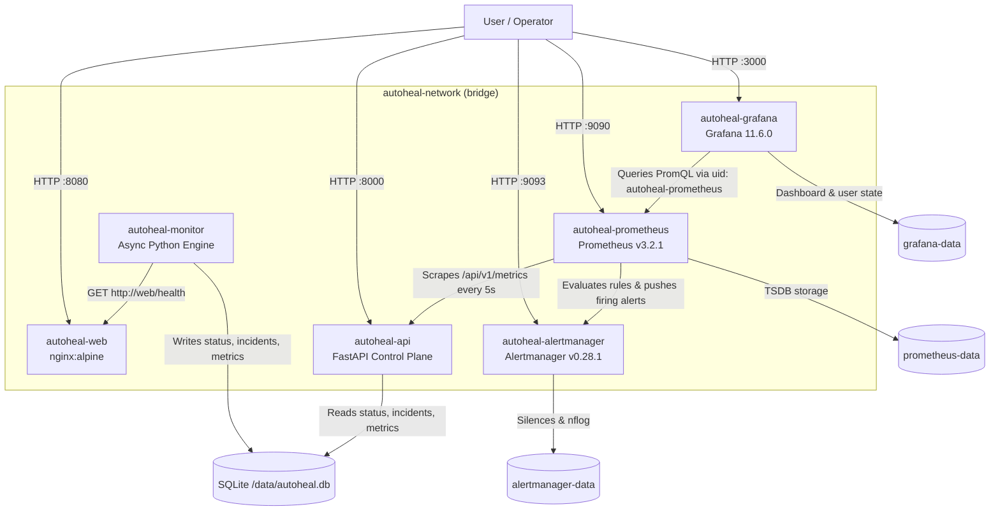

# AutoHeal — System Architecture (Phase 3)

## Overview

AutoHeal is built incrementally across cleanly separated layers:

- **Phase 1:** Containerized `nginx:alpine` target web application (`autoheal-web`) with responsive HTML and JSON `/health`.
- **Phase 2:** Independent async Python monitoring engine (`autoheal-monitor`) and decoupled FastAPI control plane (`autoheal-api`) sharing SQLite storage (`data/autoheal.db`).
- **Phase 3:** Observability and alerting stack comprising **Prometheus** (`autoheal-prometheus`), **Alertmanager** (`autoheal-alertmanager`), and **Grafana** (`autoheal-grafana`) with persistent named volumes.

> **Scope Boundary:** Phase 3 provides metric collection, alert evaluation, alert grouping/inhibition, and visualization dashboards. **Automated remediation remains intentionally excluded**; existing Ansible prototype files (`ansible/`, `docker/ansible.Dockerfile`, `remediation/recover.yml`) remain preserved on disk untouched.

## Phase 3 Architecture Diagram

## Phase 3 Observability Components

### 1. Prometheus (`autoheal-prometheus`)
- Scrapes `http://api:8000/api/v1/metrics` and `localhost:9090` every `5s` (`observability/prometheus/prometheus.yml`), preserving the `service="web"` metric label without shadowing.
- Evaluates 7 alert rules (`observability/prometheus/rules/autoheal_alerts.yml`) every `5s` covering:
  - Target service health (`AutoHealServiceDown`, `AutoHealConsecutiveCheckFailures`)
  - Monitoring engine health (`AutoHealMonitoringProbeFailures`, `AutoHealMonitoringEngineStalled`)
  - Control plane API health (`AutoHealApiDown`, `AutoHealApiServerErrors`)
  - Unresolved incident tracking (`AutoHealUnresolvedIncident`)
- Retains TSDB data for 15 days in the persistent `prometheus-data` volume.

### 2. Alertmanager (`autoheal-alertmanager`)
- Groups alerts by `['alertname', 'service', 'severity']` with configurable `group_wait`, `group_interval`, and `repeat_interval` (`observability/alertmanager/alertmanager.yml`).
- Routes alerts by `severity` (`autoheal-critical`, `autoheal-warning`, `autoheal-default`).
- Applies `inhibit_rules` so firing `AutoHealServiceDown` suppresses lower-severity `warning` alerts for the same service, and `AutoHealApiDown` suppresses `AutoHealApiServerErrors`.
- Supports swapping in an untracked local receiver file (`*.local.yml`) via `ALERTMANAGER_CONFIG_FILE` in `.env` without storing secrets in Git.

### 3. Grafana (`autoheal-grafana`)
- Automatically provisions Prometheus (`uid: autoheal-prometheus`, `http://prometheus:9090`) via `observability/grafana/provisioning/datasources/prometheus.yml`.
- Automatically loads the **AutoHeal Infrastructure Overview** dashboard (`uid: autoheal-overview`) with 10 panels covering service availability, open incidents, consecutive failures, API scrape health, check rate by outcome, p50/p95 probe latency, API request rate, incident totals, and active firing alerts.
- Persists Grafana internal state in `grafana-data`.

## Preserved Prototype Artifacts

`ansible/`, `docker/ansible.Dockerfile`, `remediation/recover.yml`, and `logs/remediation.log` remain untouched and inactive in Phase 3.
