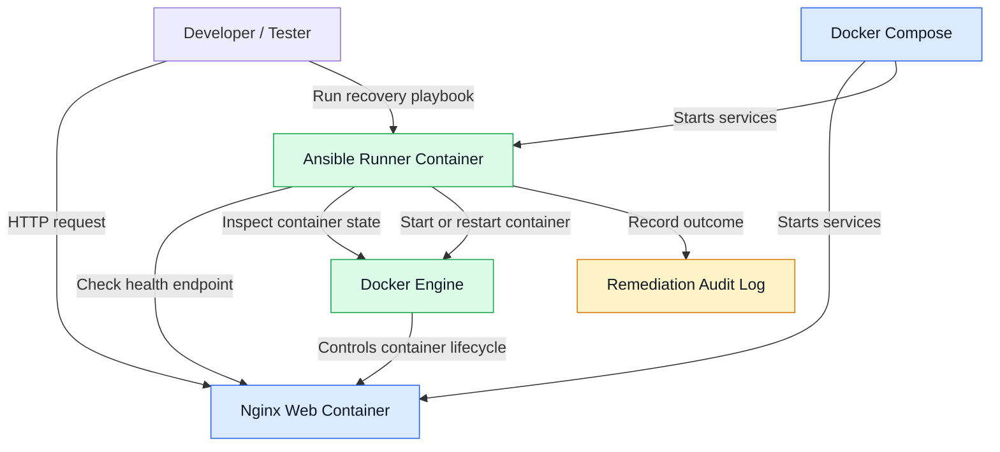

# AutoHeal — System Architecture

## Overview

AutoHeal is a local self-healing infrastructure prototype built using Docker Compose, Nginx, and Ansible. It checks service health, performs recovery actions when required, verifies recovery, and records outcomes in an audit log.

## Architecture Diagram

## Components

### Docker Compose
Orchestrates the Nginx web service and Ansible runner on a dedicated Docker network.

### Nginx
Serves the web application and provides a `/health` endpoint that returns HTTP 200 when available.

### Ansible Runner
Executes playbooks to validate the web service, inspect container state, and perform recovery actions.

### Recovery Playbook
The `remediation/recover.yml` playbook checks service health, starts a stopped container or restarts a running container when necessary, and verifies the final health status.

### Audit Log
The `logs/remediation.log` file stores timestamps and recovery outcomes.

## Recovery Workflow

1. Run the Ansible recovery playbook.
2. Check the Nginx health endpoint.
3. Inspect the Docker container state.
4. Start or restart the container when recovery is needed.
5. Retry the health check.
6. Record the outcome in the audit log.
7. Report whether recovery succeeded.

## Validation

A controlled test stopped `autoheal-web` using `docker stop autoheal-web`. The Ansible playbook started the stopped container, and the health endpoint subsequently returned HTTP 200 with the response `healthy`.

## Current Limitations

Recovery is currently triggered manually by running the playbook. Monitoring-triggered remediation, recovery rate limits, escalation, dashboards, and cloud integration remain future improvements.

## Security

The Ansible runner mounts the Docker socket, giving it significant control over the local Docker environment. Keep this setup restricted to a trusted development environment.
